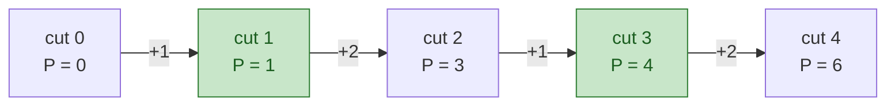
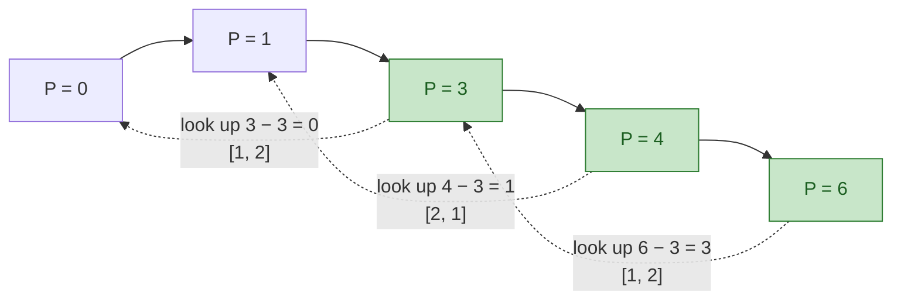
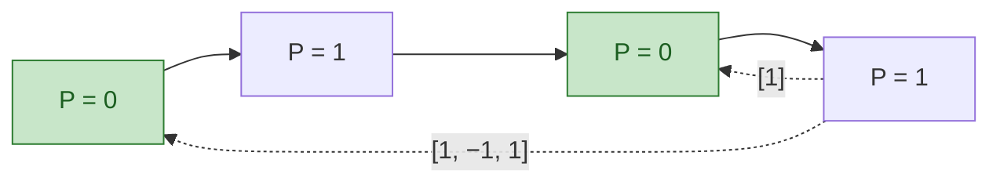
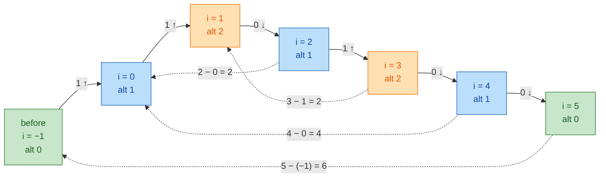
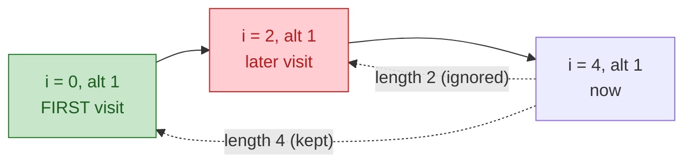
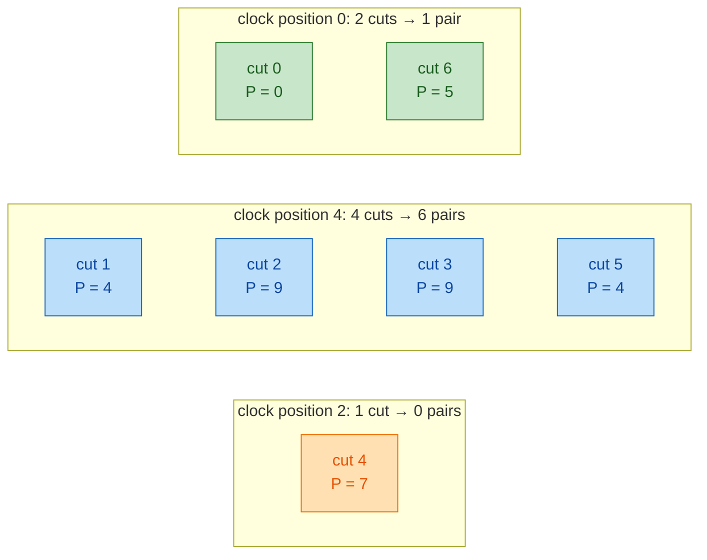
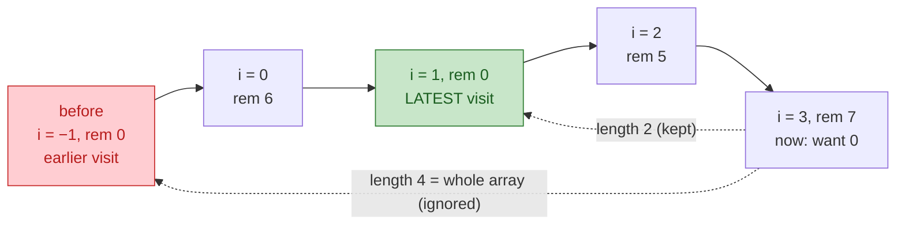

# 04. Arrays, Hashing, and Prefix Sums

Most O(n^2) array brute forces become O(n) if you remember what you've seen (hash map) or precompute running totals (prefix sums). This module covers pairs, grouping, subarray counting, range queries, and in-place tricks for values bounded by n.

Companion code: `code/04_arrays_hashing_prefix_sums.py`.

## At a glance

- **Use when:** pairs, duplicates, or grouping on unsorted data; range sums or "count subarrays with sum k" (especially with negatives); values in `1..n` with O(1) space.
- **Templates:**
  - Template 1: Frequency counting, for counts or membership
  - Template 2: Complement lookup, for pair-to-target with indices
  - Template 3: Group by canonical key, for equivalence classes
  - Template 4: 1D prefix sums, for static range queries
  - Template 5: Prefix sum + hash map, for subarray sum = k (any sign)
  - Template 6: 2D prefix sums, for rectangle queries
  - Template 7: Difference array, for offline range updates
  - Template 8: Index as hash / cyclic sort, for values in `1..n` with O(1) space
  - Template 9: Prefix/suffix accumulation, for "everything except i"
- **Typical complexity:** O(n) time, O(n) space (O(1) for cyclic sort).
- **Top trap:** forgetting the `{0: 1}` / `{0: -1}` seed, or inserting before querying.

## Core idea

Two ways to trade memory for time:

1. **Hashing: remember the past in O(1) lookups.** Rather than scanning every j, ask a dict whether i's partner appeared. Invariant: at index `i`, the map holds what you need about `nums[0..i-1]` (value → index, value → count, key → group).

2. **Prefix sums: turn range questions into differences of two points.**

```
nums:      3   -1    4    2
pre:   0   3    2    6    8          pre[i] = sum(nums[0:i]),  len n+1
sum(nums[l..r]) = pre[r+1] - pre[l]
sum(nums[1..2]) = pre[3] - pre[1] = 6 - 3 = 3   (-1 + 4)
```

Combined: a subarray ending at `i` sums to `k` when `pre[i+1] - k` is an earlier prefix sum. Hashing earlier prefixes counts these in O(n), **even with negatives** (sliding window can't).

Related tricks:
- **Difference array** (inverse of prefix sums): record a range update as `+v` at the start and `-v` past the end, then take one prefix pass.
- **Index as hash**: with values in `1..n`, the array is its own hash table. Swap each value to index `v-1` (cyclic sort) or mark presence by sign.
- **Prefix/suffix accumulation**: `answer[i] = f(left of i, right of i)`, one pass each way.

## Recognition signals

- "Two elements that sum to / differ by / XOR to X", **unsorted**, indices needed → complement lookup.
- "Contains duplicate", "first unique", "most frequent", "is an anagram", "can be rearranged into" → frequency counting.
- "Group items equivalent under reordering / shifting / renaming" → canonical key.
- "Sum between i and j", many queries, static array → prefix sums.
- "Number of subarrays with sum = k", "longest subarray with sum k", "equal number of X and Y", "sum divisible by k", with **negative or zero values** → prefix sum + hash map.
- 2D grid, many rectangle sum queries → 2D prefix sums.
- "Many range increments, then report final values" → difference array.
- n values in 1..n (or 0..n), "missing", "duplicate", "O(1) extra space" → cyclic sort / index marking.
- "For each i, aggregate all other elements" in O(n) or without division → prefix/suffix passes.
- n up to 10^5–10^6 and brute force checks all pairs/subarrays → O(n) map or O(n log n) sort.

## Disguises

1. **Budget pairing.** "A gift shop lists item prices in arrival order. A customer wants two different items that exactly use up a C-dollar gift card. Report which two listings to buy."
   Decode: two items, exactly C, unsorted, positions needed → complement lookup for C - p among earlier listings.

2. **Log signature grouping.** "Your service emits error messages with variable fields (IDs, timestamps). Bucket messages sharing a template so on-call sees one line per bug."
   Decode: "same template" is an equivalence class. Key = message with variable tokens replaced by placeholders (digits → `#`).

3. **Net-zero ledger windows.** "A bank account records daily balance changes (positive or negative). Auditors want the number of contiguous periods with net change exactly D."
   Decode: contiguous, exactly D, negatives → not sliding window. Prefix sum + count map of earlier `pre - D`.

4. **Rack power budget.** "A datacenter has n rack positions. Each maintenance job adds w watts to every rack from a to b. After all jobs, report each rack's load."
   Decode: many range increments, one final read → difference array, O(n + jobs).

5. **Shard IDs audit.** "A cluster should have shards 1 to n, one per node, but after a botched migration some IDs repeat and some are gone. Find the missing IDs with no extra memory."
   Decode: values in 1..n, length n, missing/repeated, O(1) space → cyclic sort each ID to index id-1, then scan for mismatches.

6. **Balanced traffic.** "A load balancer logs each request as routed to region A or B. Find the longest contiguous stretch where both regions served equally many."
   Decode: A → +1, B → -1, so equal counts means sum 0; "longest" → prefix sum + first-occurrence map.

## Templates and worked examples

### Template 1: Frequency counting

> - **Example problem:** [Valid Anagram (242)](https://leetcode.com/problems/valid-anagram/)
> - **Why this template:** "Anagram" means "same character counts": count both strings and compare.
> - **Worked below:** Example 1.1
> - **Also fits:** [Top K Frequent Elements (347)](https://leetcode.com/problems/top-k-frequent-elements/)

```python
def frequency_template(items: list) -> dict:
    freq: dict = defaultdict(int)
    for x in items:
        freq[x] += 1            # TODO: key may be a transformed value (x % k, x.lower())
    return dict(freq)
```

Knobs: the key (raw value, `x % k`, lowercase char, pair) and what to do with counts (compare, find count == 1, bucket by frequency). For lowercase letters, a `[0] * 26` list is faster (hash it as a tuple).

#### Example 1.1: Longest run of consecutive values [Medium]

**Problem:** [Longest Consecutive Sequence (128)](https://leetcode.com/problems/longest-consecutive-sequence/) · **Template:** Template 1 (Frequency counting)

**Problem.** Given an unsorted integer array, return the length of the longest run of consecutive integers among its values (in any positions). O(n) required. Example: `[100, 4, 200, 1, 3, 2]` → `4` (the run `1, 2, 3, 4`).

<details>
<summary>Decode, approach, and solution</summary>

**Decode:** O(n) rules out sorting. Only membership matters ("is `x + 1` present?"), so Template 1's counter becomes a set.

**Approach:** Put every value in a set. `x` **heads** a run when `x - 1` is absent; walk upward only from heads. Each value is walked once, from its run's head, so the inner `while` does O(n) total work. Iterate over the set, not the list, so duplicate heads aren't walked twice.

```python
def longest_consecutive(nums: list[int]) -> int:
    s = set(nums)
    best = 0
    for x in s:
        if x - 1 not in s:
            y = x
            while y + 1 in s:
                y += 1
            best = max(best, y - x + 1)
    return best
```

**Complexity:** O(n) time (each value is head-tested once and stepped over at most once), O(n) space.

**Edge cases:** Empty → 0. The set absorbs duplicates (`[0, 0, 1]` → 2); negatives just work. Without the `x - 1 not in s` check, one long run makes it O(n^2). If O(n) is relaxed, sort in O(n log n).

</details>

### Template 2: Complement lookup

> - **Example problem:** [Two Sum (1)](https://leetcode.com/problems/two-sum/)
> - **Why this template:** Unsorted, "two numbers add up to target", indices required: look up `target - x` among earlier values.
> - **Worked below:** Example 2.1

```python
def complement_template(nums: list[int], target: int) -> tuple[int, int] | None:
    seen: dict[int, int] = {}                # value -> index (TODO: or count, or first index)
    for i, x in enumerate(nums):
        need = target - x                    # TODO: complement rule (target - x, x ^ k, x - k ...)
        if need in seen:
            return seen[need], i
        seen[x] = i
    return None
```

Knobs: the complement rule; what to store (index for positions, count for "how many pairs"); for "difference = k", check both `x - k` and `x + k`. **Look up before inserting** so an element never pairs with itself.

#### Example 2.1: Pair with target sum [Easy]

**Problem:** [Two Sum (1)](https://leetcode.com/problems/two-sum/) · **Template:** Template 2 (Complement lookup)

**Problem.** Given an unsorted integer array and a target, return two distinct indices whose values sum to the target. Exactly one answer exists.

<details>
<summary>Decode, approach, and solution</summary>

**Decode:** Unsorted, original indices, pair sum → complement lookup. Sorting loses indices (or costs O(n log n) plus bookkeeping).

**Approach:** Map `value → index` for everything before `i`, and look up `target - nums[i]`. Checking before inserting handles `[3, 3]` (target 6) without a 3 pairing with itself.

```python
def two_sum(nums: list[int], target: int) -> list[int]:
    seen: dict[int, int] = {}
    for i, x in enumerate(nums):
        if target - x in seen:
            return [seen[target - x], i]
        seen[x] = i
    return []
```

**Complexity:** O(n) time (expected O(1) per lookup/insert), O(n) space.

**Edge cases:** Duplicates (`[3, 3]`), negatives, no answer (return `[]` or raise; ask). If sorted, two pointers use O(1) space (module 05).

</details>

### Template 3: Group by canonical key

> - **Example problem:** [Group Anagrams (49)](https://leetcode.com/problems/group-anagrams/)
> - **Why this template:** Anagram grouping is an equivalence relation: map each word to a canonical key (sorted letters) and bucket by key.
> - **Worked below:** Example 3.1

```python
def group_by_key_template(items: list[str]) -> list[list[str]]:
    groups: dict = defaultdict(list)
    for item in items:
        key = tuple(sorted(item))            # TODO: canonical form / signature
        groups[key].append(item)
    return list(groups.values())
```

Common canonical keys:

| Equivalence | Key |
|---|---|
| Anagrams | `tuple(sorted(s))` or 26-count tuple |
| Same shift pattern ("abc" ~ "bcd") | tuple of `(ord(s[i]) - ord(s[0])) % 26` |
| Isomorphic ("egg" ~ "add") | tuple of first-occurrence indices: `tuple(s.index(c) for c in s)` (O(L^2); use a dict for O(L)) |
| Same set, any order | `frozenset(items)` |
| Same line through a point | reduced slope `(dy // g, dx // g)` with sign normalized |

#### Example 3.1: Group words by anagram [Medium]

**Problem:** [Group Anagrams (49)](https://leetcode.com/problems/group-anagrams/) · **Template:** Template 3 (Group by canonical key)

**Problem.** Partition a list of lowercase words into groups of words that are rearrangements of each other.

<details>
<summary>Decode, approach, and solution</summary>

**Decode:** Equivalence relation → canonical key + dict of lists.

**Approach:** Two keys: sorted string (O(L log L) per word) or 26-count tuple (O(L + 26)). The count tuple is asymptotically faster; the sorted key is shorter. Mention both, write one.

```python
def group_anagrams(words: list[str]) -> list[list[str]]:
    groups: dict[tuple[int, ...], list[str]] = defaultdict(list)
    for w in words:
        counts = [0] * 26
        for ch in w:
            counts[ord(ch) - ord("a")] += 1
        groups[tuple(counts)].append(w)
    return list(groups.values())
```

**Complexity:** O(N·L) time for N words of max length L (plus O(26) per word to hash), O(N·L) space for the output.

**Edge cases:** Empty string forms its own group. Unicode or uppercase breaks the 26-slot assumption: use `tuple(sorted(w))` or `frozenset(Counter(w).items())`.

</details>

### Template 4: 1D prefix sums

> - **Example problem:** [Range Sum Query - Immutable (303)](https://leetcode.com/problems/range-sum-query-immutable/)
> - **Why this template:** Many `sumRange(left, right)` queries on a fixed array: precompute prefix sums once, answer each query as a difference.
> - **Worked below:** Example 4.1, Example 4.2

```python
class PrefixSum:
    def __init__(self, nums: list[int]) -> None:
        self.pre = [0] * (len(nums) + 1)
        for i, x in enumerate(nums):
            self.pre[i + 1] = self.pre[i] + x

    def range_sum(self, left: int, right: int) -> int:
        return self.pre[right + 1] - self.pre[left]
```

Length `n+1` with `pre[0] = 0` avoids special-casing ranges that start at 0. Works for any invertible operation: `+`/`-`, XOR (`pre[r+1] ^ pre[l]`), counts of a property (vowels). Not min/max.

#### Example 4.1: Many range-sum queries on a fixed array [Easy]

**Problem:** [Range Sum Query - Immutable (303)](https://leetcode.com/problems/range-sum-query-immutable/) · **Template:** Template 4 (1D prefix sums)

**Problem.** Build a structure over a fixed integer array that answers `sumRange(left, right)` (inclusive) for many queries. Example: `[-2, 0, 3, -5, 2, -1]`, `sumRange(0, 2)` → 1, `sumRange(2, 5)` → -1.

<details>
<summary>Decode, approach, and solution</summary>

**Decode:** Fixed array + many range-sum queries → precompute prefix sums once.

**Approach:** `pre[i]` = sum of `nums[:i]`, so `pre[0] = 0` and `sum(nums[l..r]) = pre[r+1] - pre[l]`: the prefix through `r` minus the prefix before `l`.

```python
class NumArray:
    def __init__(self, nums: list[int]) -> None:
        self.pre = [0]
        for x in nums:
            self.pre.append(self.pre[-1] + x)

    def sumRange(self, left: int, right: int) -> int:
        return self.pre[right + 1] - self.pre[left]
```

**Complexity:** O(n) build, O(1) per query, O(n) space. Summing per query would be O(n) each.

**Edge cases:** `left = 0` works because of `pre[0] = 0`. `left = right` returns the element. Updates between queries break this: use a Fenwick tree.

</details>

#### Example 4.2: Best single buy/sell profit (running prefix minimum) [Easy]

**Problem:** [Best Time to Buy and Sell Stock (121)](https://leetcode.com/problems/best-time-to-buy-and-sell-stock/) · **Template:** Template 4 (1D prefix sums), generalized to a prefix minimum

**Problem.** Given daily prices, choose one day to buy and a later day to sell to maximize profit; return 0 if no profit is possible. Example: `[7, 1, 5, 3, 6, 4]` → 5 (buy at 1, sell at 6).

<details>
<summary>Decode, approach, and solution</summary>

**Decode:** Best `prices[j] - prices[i]` with `i < j` → for each sell day `j`, you need an aggregate of the prefix before it. A prefix aggregate generalizes prefix sums: sum, min, or max of `prices[0..j]`, maintained in one pass.

**Approach:** Track `lowest` = min of the prefix so far. Selling on day `j`, the best buy is `lowest`, so the answer is the max of `p - lowest`. Min is not invertible, so this answers prefix questions only, not arbitrary `[l, r]` ranges (that needs a sparse table or segment tree). Updating `lowest` before computing the profit allows a zero-profit same-day pair, which is harmless.

```python
def max_profit(prices: list[int]) -> int:
    lowest = float("inf")
    best = 0
    for p in prices:
        lowest = min(lowest, p)
        best = max(best, p - lowest)
    return best
```

**Complexity:** O(n) time, O(1) space (only the running aggregate is kept, not the whole prefix array).

**Edge cases:** Falling prices → 0. One day → 0. A new low after the best pair (`[2, 4, 1]`) doesn't hurt: `best` already holds 2.

</details>

### Template 5: Prefix sum + hash map

> - **Example problem:** [Subarray Sum Equals K (560)](https://leetcode.com/problems/subarray-sum-equals-k/)
> - **Why this template:** "Count contiguous subarrays with sum exactly k" with negatives allowed: look up `running - k` among earlier prefix sums.
> - **Worked below:** Example 5.1
> - **Also fits:** [Contiguous Array (525)](https://leetcode.com/problems/contiguous-array/)

```python
def count_subarrays_template(nums: list[int], k: int) -> int:
    seen = defaultdict(int)
    seen[0] = 1                              # empty prefix: lets subarrays start at index 0
    running = count = 0
    for x in nums:
        running += x                         # TODO: transform (x -> 1/-1, x % 2, ...)
        count += seen[running - k]           # TODO: key may be (running % k) etc.
        seen[running] += 1
    return count


def longest_subarray_template(nums: list[int], k: int) -> int:
    first = {0: -1}                          # prefix 0 seen 'before' index 0
    running = best = 0
    for i, x in enumerate(nums):
        running += x
        if running - k in first:
            best = max(best, i - first[running - k])
        if running not in first:             # keep earliest to maximize length
            first[running] = i
    return best
```

Knobs:

| Variant | Map stores | Seed | Lookup key |
|---|---|---|---|
| Count subarrays with sum k | prefix → count | `{0: 1}` | `running - k` |
| Longest subarray with sum k | prefix → first index | `{0: -1}` | `running - k` |
| Shortest subarray with sum k | prefix → **last** index | `{0: -1}` | `running - k` |
| Sum divisible by k (count) | remainder → count | `{0: 1}` | `running % k` |
| Equal 0s and 1s | map 0 → -1, then sum 0 | `{0: -1}` | `running` |
| Count with exactly k odd numbers | map odd → 1, even → 0 | `{0: 1}` | `running - k` |
| XOR equals k | prefix XOR → count | `{0: 1}` | `running ^ k` |

Invariant: when querying at index `i`, the map holds only prefixes ending before `i + 1` (hence **query, then insert**).

**Why this beats sliding window here**: a window needs monotonicity (extending never decreases the sum), guaranteed only for non-negative values; prefix + hash assumes nothing.

**How to see it: subarrays are pairs of cut points.** Put a cut before index 0 and after every element. `P[j]` is the running total at cut `j` (`P[0] = 0`, the empty prefix). The subarray between cuts `i` and `j` sums to `P[j] - P[i]`. For `nums = [1, 2, 1, 2]`:


The subarray between the green cuts is `[2, 1]`, and its sum is `4 - 1 = 3`, the distance travelled between them. Checking every pair of cuts is O(n²). The hash map finds the matching earlier cut in O(1) instead.

Every problem using this template sets three knobs:

1. **Key:** what to remember about each cut (the running sum, a ±1 balance, a remainder, an XOR, a parity mask). It must **cancel out** between two cuts: sums, counts, remainders, XOR, and parities do; max, min, and distinct counts don't.
2. **Match rule:** for the current key, which earlier key makes the subarray good? Write `good(start, end)` and solve for `start`: sum = k → `end - k`; balanced or divisible → `end`; XOR = k → `end ^ k`.
3. **Stored value:** "how many" → a count; "longest" → the **first** index; "shortest" → the **last** index. Seed the empty prefix to match: `{0: 1}` for counts, `{0: -1}` for indices.

The loop is the same every time: **update the key, look up its partners, then record the key.**

**Two pictures for choosing the key: the hill and the clock.** Both picture the running value as a walk. They differ in whether whole multiples of k matter.

*The hill (exact values).* Each element moves your altitude up or down by its value: a sum, or a transformed value like +1 for a 1 and −1 for a 0. A subarray is the stretch between two points of the walk, and its sum is the **height difference**. Use it when the actual size of the total matters:

- "sum = 0", "balanced", "equal counts" → the **same height** (Part 2).
- "sum = k" → a point **k lower** (Part 1).
- "more X than Y", "sum ≥ k" → **any lower point**. That's an inequality, not an exact match, so a dictionary isn't enough on its own: see the inequality tools in `06b-beyond-sliding-window.md`.

*The clock (remainders only).* Wrap the hill's height axis around a circle with k positions. Heights 4, 9, 14, −1 all land on position 4, because they're whole laps (multiples of k) apart. Use it when **both** of these hold:

1. **Whole multiples of k don't matter.** The question only cares about the remainder ("divisible by k", "multiple of k", "remainder r"). The clock deliberately forgets full laps, so if the actual size matters, it loses information.
2. **The value is built by adding.** Adding moves the hand forward, subtracting moves it back, and a full lap returns it to the same spot. This doesn't work for products: 2 × 3 is divisible by 6 even though neither factor is, so "same spot = valid" fails. Products and divisors call for gcd or prime factors instead.

**The payoff:** "`P(j) − P(i)` is divisible by k" looks like infinitely many targets (`P(j)`, `P(j) − k`, `P(j) − 2k`, …). On the clock it becomes "`P(i)` is at the **same position** as `P(j)`": one exact lookup. So the key is `running % k` (Part 3).

**Self-test:** *if I replaced every number with its remainder mod k, would the answer stay the same?* If yes, use the clock. If no, use the hill.

| The problem says | Picture | Key | Match rule |
|---|---|---|---|
| sum = 0, balanced, equal counts, net zero | hill | running sum (after a ±1 or weighted transform) | same height |
| sum = k, X exceeds Y by exactly k | hill | running sum | k lower |
| more X than Y, sum ≥ k | hill | running sum | any lower point: not a dictionary lookup (06b) |
| divisible by k, multiple of k | clock | `running % k` | same position |
| remainder r (e.g. "remove a part so the rest is divisible") | clock | `running % k` | r positions back (Part 4) |
| **pairs** whose sum is divisible by k ([Pairs of Songs With Total Durations Divisible by 60 (1010)](https://leetcode.com/problems/pairs-of-songs-with-total-durations-divisible-by-60/)) | clock | `x % k` per element | positions that complete a lap: `r` with `(k − r) % k` |
| subarray **length** divisible by k ([Maximum Subarray Sum With Length Divisible by K (3381)](https://leetcode.com/problems/maximum-subarray-sum-with-length-divisible-by-k/)) | clock on the **index** | `index % k` | same position |
| product divisible by k, gcd, divisors | neither | prime factors / gcd | (different technique) |

Part 2 builds the hill step by step, and Part 3 shows how wrapping it turns into the clock.

#### Example 5.1: Count subarrays summing to k [Medium]

**Problems:** [Subarray Sum Equals K (560)](https://leetcode.com/problems/subarray-sum-equals-k/), [Contiguous Array (525)](https://leetcode.com/problems/contiguous-array/), [Subarray Sums Divisible by K (974)](https://leetcode.com/problems/subarray-sums-divisible-by-k/), [Make Sum Divisible by P (1590)](https://leetcode.com/problems/make-sum-divisible-by-p/) · **Template:** Template 5 (Prefix sum + hash map)

**Problem.** Given integers (possibly negative) and k, count contiguous subarrays summing to exactly k. Then three variants: the longest subarray with equal 0s and 1s (525), the number of subarrays whose sum is divisible by k (974), and the shortest subarray to remove so the rest is divisible by p (1590).

<details>
<summary>Decode, approach, and solution</summary>

**Decode:** Contiguous, count, exact sum, negatives (which rule out sliding window) → prefix sum + hash map.

##### Part 1: [Subarray Sum Equals K (560)](https://leetcode.com/problems/subarray-sum-equals-k/)

**Knobs:** key = running sum. Match rule = `running - k` (sum of `(i, j]` = `P[j] - P[i] = k`, so `P[i] = P[j] - k`). Stored value = count, because the question is "how many".

**Approach:** at each element, ask: "how many earlier cuts had running total `running - k`?" Each one is the start of a subarray ending here with sum `k`. Seed `{0: 1}` so subarrays starting at index 0 have a start cut.

```python
def subarray_sum_equals_k(nums: list[int], k: int) -> int:
    seen = defaultdict(int)
    seen[0] = 1
    running = count = 0
    for x in nums:
        running += x
        count += seen[running - k]
        seen[running] += 1
    return count
```

**Trace** for `[1, 2, 1, 2]`, `k = 3` (answer 3). The dotted arrows are lookups that found an earlier cut:



| x | running | look up `running - k` | `seen` has it? | count | seen after |
|---|---|---|---|---|---|
| start | 0 | | | 0 | {0:1} |
| 1 | 1 | −2 | no | 0 | {0:1, 1:1} |
| 2 | 3 | 0 | 1 time → `[1, 2]` | 1 | {0:1, 1:1, 3:1} |
| 1 | 4 | 1 | 1 time → `[2, 1]` | 2 | {…, 4:1} |
| 2 | 6 | 3 | 1 time → `[1, 2]` | 3 | {…, 6:1} |

**Why `count += seen[...]` and not `+= 1`:** a running total can repeat, and every earlier occurrence is a different start. For `[1, -1, 1]`, `k = 1`, the cuts are `0, 1, 0, 1`. At the last cut you look up `1 - 1 = 0`, and `seen[0]` is **2**:


Two subarrays end at the last element, so `count` goes up by 2 (3 in total, with the `[1]` at index 0). Negatives make the running total go down and revisit old values. The map handles that without any extra logic, which is exactly where a sliding window fails.

**Why look up before recording:** the current cut must not match itself (an empty subarray). With `k = 0`, recording first would count every position once too often.

**Complexity:** O(n) time, O(n) space for the map.

**Edge cases:** k = 0 (query before insert). Zeros create many equal prefixes, which the count map handles. Without `seen[0] = 1`, every subarray starting at index 0 is missed.

##### Part 2: [Contiguous Array (525)](https://leetcode.com/problems/contiguous-array/)

**Knobs:** key = running **balance** (+1 for a 1, −1 for a 0). Match rule = the **same** balance (equal 0s and 1s ⇔ the balance changed by 0). Stored value = the **first** index, because the question is "longest".

**Approach:** think of the balance as altitude: 1 is a step up, 0 a step down. A stretch has equal 0s and 1s exactly when it **ends at the altitude it started at**. For the longest stretch ending here, go back to the **earliest** time you were at this altitude.

```python
def longest_balanced_binary(nums: list[int]) -> int:
    # LeetCode: Contiguous Array. 0 -> -1, then longest subarray with sum 0.
    first = {0: -1}
    running = best = 0
    for i, x in enumerate(nums):
        running += 1 if x == 1 else -1
        if running in first:
            best = max(best, i - first[running])
        else:
            first[running] = i
    return best
```

**Trace** for `[1, 1, 0, 1, 0, 0]` (answer 6). The walk climbs first, then comes back down. Same color = same altitude; arrows point to the **first** visit of that altitude:



| i | x | altitude | first visit? | length `i - first[alt]` | best | first (after) |
|---|---|---|---|---|---|---|
| start | | 0 | | | 0 | {0: −1} |
| 0 | 1 | 1 | yes → record | | 0 | {0:−1, 1:0} |
| 1 | 1 | 2 | yes → record | | 0 | {…, 2:1} |
| 2 | 0 | 1 | no, first at 0 | 2 → `[1, 0]` | 2 | unchanged |
| 3 | 1 | 2 | no, first at 1 | 2 → `[0, 1]` | 2 | unchanged |
| 4 | 0 | 1 | no, first at 0 | 4 → `[1, 0, 1, 0]` | 4 | unchanged |
| 5 | 0 | 0 | no, first at −1 | 6 → whole array | **6** | unchanged |

**Why keep only the first index:** at `i = 4` the altitude 1 was visited at `i = 0` and `i = 2`. Either gives a balanced stretch, but the earlier visit gives the longer one:


That's why the code has `else: first[running] = i`: a key is written once and never overwritten. If you wanted the **shortest** stretch instead, you'd overwrite on every visit (store the last index).

**Why `{0: -1}`:** before index 0 you're at altitude 0. Placing that visit at index −1 makes `i - (-1)` the length of a stretch starting at index 0, which is how `i = 5` finds the whole array.

**Complexity:** O(n) time, O(n) space (an array of size 2n + 1 also works, since the balance is in [−n, n]).

**The intuition: why matching altitudes means "balanced".** Picture a hike: every 1 is a step up, every 0 a step down, and the altitude is (1s so far) − (0s so far). If a stretch **ends at the altitude it started at**, its ups and downs cancelled exactly, so it had as many 1s as 0s. The reverse holds too, so: **balanced stretch ⇔ same altitude at both ends**. Plotting the altitude after each element of `[1, 1, 0, 1, 0, 0]`:

```
alt   before  i=0   i=1   i=2   i=3   i=4   i=5
 2                   *           *
 1             *           *           *
 0      *                                    *
```

Draw a horizontal line through any row: **every pair of points on the same line bounds a balanced subarray**.

- **Row 2:** i=1 and i=3 → length 2 (`[0, 1]`).
- **Row 1:** i=0, 2, 4 → pairs (0,2), (2,4), (0,4); the longest is (0,4), length 4 (`[1, 0, 1, 0]`).
- **Row 0:** "before" and i=5 → the whole array (length 6).

The same picture answers every question you can ask:

- **Longest:** the leftmost and rightmost points on each row → store the **first** index per altitude.
- **Count:** the number of pairs on each row → store **how many times** each altitude was visited.
- **Shortest:** neighboring points on a row → store the **latest** index.

**Why one number is enough:** "balanced" depends only on the **difference** between the two counts, so the two counters collapse into one. That's the real skill: **find the single quantity the condition is about, and track its running value.** Then "this stretch satisfies the condition" becomes "the quantity changed by the right amount between the two ends".

**How it generalizes: change what "altitude" means.** Every variant is still "walk, track your position, match positions".

1. **A non-zero target**, "1s exceed 0s by exactly k": end **k higher** than you started, so the start's altitude is `current − k`. That's Part 1 (Subarray Sum = K) with ±1 steps.
2. **Different step sizes**, "#A is exactly twice #B": `#A − 2·#B = 0`, so step **+1 for A** and **−2 for B**, then match equal altitudes. **Rule:** any condition `a·#X + b·#Y + … = 0` becomes steps of size a, b, …
3. **More than two categories**, "equal numbers of a, b, and c": the altitude becomes a **2D grid position** `(count_a − count_b, count_b − count_c)`. Balanced means the walk **returns to the same grid point**; the dictionary keys are tuples.
4. **Wrap-around**, "sum divisible by k": the walk is on a **circle** of k positions (`running % k`). Returning to the same point means a whole number of laps, a multiple of k. That's Part 3.
5. **On/off positions**, "every vowel appears an even number of times": each vowel is a light switch flipped by each occurrence, and the position is the on/off state of all five, stored as a bitmask. All switches back where they were means every count changed by an even number ([Find the Longest Substring Containing Vowels in Even Counts (1371)](https://leetcode.com/problems/find-the-longest-substring-containing-vowels-in-even-counts/)).
6. **An inequality**, "more 1s than 0s": now you must end **strictly higher** than you started, so there's no exact altitude to look up. The picture still helps: for the longest stretch, you want the **earliest point lower than where you are now**. With ±1 steps the walk can't skip altitudes, so to reach your current altitude you must have passed through `current − 1` first. So the earliest lower point is the first visit to `current − 1`, and a dictionary lookup works again (the trick in [Longest Well-Performing Interval (1124)](https://leetcode.com/problems/longest-well-performing-interval/)). With arbitrary step sizes that isn't guaranteed: use a monotonic stack for the longest, or a Fenwick tree to count (`06b-beyond-sliding-window.md`, Templates 4 and 6).

**Recognition cues for the altitude picture:**

| The problem says | Position to track | Match rule |
|---|---|---|
| "equal number of X and Y", "as many X as Y", "balanced", "net zero", "returns to the starting state" | difference (or weighted sum) of counts | same position |
| "X exceeds Y by exactly k" | difference of counts | position − k |
| "divisible by", "multiple of" | running sum mod k (a circle) | same position |
| "even number of times", "pairs up" | parity bitmask (switches) | same mask |
| "more X than Y", "at least" | difference of counts | a **lower** point: not an exact match (06b) |

**Four steps for a new problem:**

1. **What single quantity is the condition about?** (difference, weighted sum, remainder, parity mask, tuple)
2. **How does each element move it?** (+1/−1, weights, mod, bit flip)
3. **What must the start's position be, given the end's?** (equal, minus k, or "lower" → a different tool)
4. **What does the question ask?** (longest → first visit, count → number of visits, shortest → latest visit)

Steps 1 and 2 hold the insight: choosing what "altitude" means. Steps 3 and 4 are the same mechanics every time.

##### Part 3: [Subarray Sums Divisible by K (974)](https://leetcode.com/problems/subarray-sums-divisible-by-k/)

**Knobs:** key = running sum **mod k**. Match rule = the **same** remainder. Stored value = count, because the question is "how many".

**Why equal remainders work: wrap the hill into a clock.** Take `[4, 5, 0, -2, -3, 1]` with `k = 5`. Its running totals at cuts 0–6 are `0, 4, 9, 9, 7, 4, 5`.

*Step 1: the hill, with a "floor" every k units.* Plot the running totals as altitudes, as in Part 2, and draw a floor line at every multiple of 5:

```
height   c0   c1   c2   c3   c4   c5   c6
   9                *    *                     cuts 2, 3 → clock 4
   8
   7                          *                cut 4 → clock 2
   6
   5  ----------------------------------*---   floor 1 · cut 6 → clock 0
   4           *                   *           cuts 1, 5 → clock 4
   3
   2
   1
   0  ----*---------------------------------   floor 0 · cut 0 → clock 0
```

The subarray between two cuts sums to their height difference. Cuts 1 and 2 (heights 4 and 9) differ by 5, so `nums[1..1] = [5]` is divisible by 5. But they sit at **different heights**, so Part 2's "draw a horizontal line" trick doesn't find them. What they share is their **position within a floor**: both are 4 above the floor below them. Two heights differ by a multiple of 5 exactly when they're at the same spot on their floors (that spot is `height % 5`).

*Step 2: collapse all the floors into one: a clock with k positions.* Wrap the height axis around a circle so that 0, 5, 10, … land on the same spot, and so do 4, 9, 14, … Each cut lands on position `running % 5`:

```
                     clockwise ↻
                ┌──────────────────┐
                │ position 0       │
                │ cuts 0, 6        │
                │ → 1 pair         │
                └──────────────────┘

┌──────────────────┐            ┌──────────────────┐
│ position 4       │            │ position 1       │
│ cuts 1, 2, 3, 5  │            │ (empty)          │
│ → 6 pairs        │            │                  │
└──────────────────┘            └──────────────────┘

     ┌──────────────────┐  ┌──────────────────┐
     │ position 3       │  │ position 2       │
     │ (empty)          │  │ cut 4            │
     │                  │  │ → 0 pairs        │
     └──────────────────┘  └──────────────────┘
```

Now the rule looks like Part 2's again: **two cuts on the same position bound a subarray whose sum is divisible by k.** Being at the same position means they're a whole number of laps apart, and a lap is k. Count pairs at each position: 1 + 0 + 0 + 0 + 6 = 7, which is the answer. (The same check on bigger numbers: `14 % 5 = 4` and `29 % 5 = 4`, and `29 − 14 = 15 = 3 × 5`.)

```python
def subarrays_div_by_k(nums: list[int], k: int) -> int:
    # LeetCode: Subarray Sums Divisible by K. Equal remainders => divisible difference.
    seen = defaultdict(int)
    seen[0] = 1
    running = count = 0
    for x in nums:
        running = (running + x) % k
        count += seen[running]
        seen[running] += 1
    return count
```

**Trace:** the same clock, as buckets. Each bucket is one clock position, and the cuts in it are the ones that landed there:


**Every pair of cuts in the same bucket is one valid subarray.** The answer is the number of same-bucket pairs: 1 + 6 + 0 = 7. The loop counts those pairs one cut at a time: when a cut arrives, it pairs with every cut already in its bucket (`count += seen[running]`), then joins the bucket (`seen[running] += 1`).

**Walking the clock hand.** The loop moves a clock hand by each element: forward for positive numbers, backward for negative ones. Wherever the hand lands, every earlier visit to that spot starts a valid subarray ending here (`count += seen[running]`). Then the hand marks the spot (`seen[running] += 1`):

| x | hand move | lands on (`running % 5`) | earlier visits here | count | seen after |
|---|---|---|---|---|---|
| start | starts at 0 | 0 | | 0 | {0:1} |
| 4 | forward 4 | 4 | 0 | 0 | {0:1, 4:1} |
| 5 | forward 5 = **one full lap** | 4 | 1 → `[5]` | 1 | {0:1, 4:2} |
| 0 | doesn't move | 4 | 2 → `[0]`, `[5, 0]` | 3 | {0:1, 4:3} |
| −2 | back 2 | 2 | 0 | 3 | {…, 2:1} |
| −3 | back 3, passing 0 | 4 | 3 → `[-2, -3]`, `[0, -2, -3]`, `[5, 0, -2, -3]` | 6 | {…, 4:4} |
| 1 | forward 1, passing 4 → 0 | 0 | 1 → the whole array (sum 5) | **7** | {0:2, …} |

Look at the rows for `5` and `0`. A full lap, or no move at all, leaves the hand where it was. That's exactly why `[5]` and `[0]` are valid: their sums are multiples of 5. The rows for `−2` and `−3` show that negative numbers just turn the hand backward. `−2 − 3 = −5` is a full lap backward, so the hand lands back on 4, and `[-2, -3]` is valid.

**Hill or clock?** The clock is the hill wrapped every k units. For when to use each, see "Two pictures for choosing the key" just before Example 5.1.

Python's `%` is non-negative for positive `k` (`-2 % 5 == 3`, and `(2 - 3) % 5 == 4` above); in Java/C++ write `((running % k) + k) % k`, or negative remainders land in the wrong bucket.

**Complexity:** O(n) time, O(min(n, k)) space.

##### Part 4: [Make Sum Divisible by P (1590)](https://leetcode.com/problems/make-sum-divisible-by-p/), the "shortest" variant

**Problem.** Remove the shortest contiguous subarray (not the whole array) so the remaining sum is divisible by `p`. Return its length, or −1 if impossible.

**Derive it with the key question: fix the end, then what must the start satisfy?** Removing `nums[start+1..end]` leaves `total - removed`. That's divisible by `p` exactly when `removed % p == total % p`. Call that remainder `need`. With running sums mod `p`:

```
(P[end] - P[start]) % p == need    →    P[start] % p == (P[end] - need) % p
```

The start needs one exact remainder, so a dictionary can find it.

**Knobs:** key = running sum mod `p`. Match rule = `(key - need) % p`. Stored value = the **last** index, because the question is "shortest". Seed `{0: -1}` (a removal can start at index 0).

```python
def min_subarray_to_remove(nums: list[int], p: int) -> int:
    need = sum(nums) % p
    if need == 0:
        return 0
    last = {0: -1}
    running = 0
    best = len(nums)
    for i, x in enumerate(nums):
        running = (running + x) % p
        want = (running - need) % p
        if want in last:
            best = min(best, i - last[want])
        last[running] = i
    return best if best < len(nums) else -1
```

**Trace** for `[6, 3, 5, 2]`, `p = 9` (answer 2). The total is 16, so `need = 16 % 9 = 7`:

| i | x | running % 9 | want `(running − 7) % 9` | last has it? | length | best | last (after) |
|---|---|---|---|---|---|---|---|
| start | | 0 | | | | 4 (none yet) | {0: −1} |
| 0 | 6 | 6 | 8 | no | | 4 | {0:−1, 6:0} |
| 1 | 3 | 0 | 2 | no | | 4 | {0:**1**, 6:0} ← overwrites −1 |
| 2 | 5 | 5 | 7 | no | | 4 | {…, 5:2} |
| 3 | 2 | 7 | 0 | yes, at **1** | 3 − 1 = 2 → remove `[5, 2]` | **2** | {…, 7:3} |

Check: removing `[5, 2]` (sum 7) leaves `6 + 3 = 9`, which is divisible by 9 ✓.

**Why keep the last index:** at `i = 3` you need remainder 0, and it was seen twice: before the array (index −1) and at `i = 1`. The later one gives the shorter removal:


This is the mirror image of Part 2's diagram. There you keep the **first** visit, because the farthest start gives the longest stretch. Here you keep the **latest** visit, because the closest start gives the shortest stretch. So the code writes `last[running] = i` on **every** step, with no `if`/`else`. If you kept the first index out of habit, this input would return −1 instead of 2: the only match would be the whole array, which isn't allowed.

**Two more details:**
- **`need == 0` → return 0:** the array is already divisible, so nothing needs removing.
- **`best < len(nums)`:** the one match that spans the whole array is ruled out ("not the whole array"), so a best of `n` means −1.

**Complexity:** O(n) time, O(min(n, p)) space.

**Edge cases:** Python's `%` keeps `want` in `0..p−1` even when `running < need`; in Java/C++ write `((running - need) % p + p) % p`. Sums can be large: Python is fine, Java needs the running remainder (never the raw sum) to avoid overflow.

##### The four parts side by side

| | 560 Sum = K | 525 Contiguous Array | 974 Divisible by K | 1590 Divisible by P |
|---|---|---|---|---|
| Key | running sum | running ±1 balance | running sum % k | running sum % p |
| Match rule | `key - k` | same key | same key | `(key - need) % p` |
| Stored value | count | first index | count | last index |
| Seed | `{0: 1}` | `{0: -1}` | `{0: 1}` | `{0: -1}` |
| Because | how many | longest | how many | shortest |
| Write to the map | every step (+1) | only the first visit | every step (+1) | every step (overwrite) |

**Try the knobs on new problems** (decode before reading):

- *Count subarrays with exactly k odd numbers* ([Count Number of Nice Subarrays (1248)](https://leetcode.com/problems/count-number-of-nice-subarrays/)): key = running count of odd numbers; match `key - k`; counts.
- *Longest substring where every vowel appears an even number of times* ([Find the Longest Substring Containing Vowels in Even Counts (1371)](https://leetcode.com/problems/find-the-longest-substring-containing-vowels-in-even-counts/)): key = 5-bit mask of vowel parities (flip a bit per vowel); match the same mask; first index.
- *Count subarrays whose XOR is k*: key = running XOR; match `key ^ k`; counts.
- *Shortest subarray with sum exactly k, negatives allowed*: key = running sum; match `key - k`; **last** index (overwrite every step), seed `{0: -1}`.
- *Longest substring with equal numbers of a, b, and c*: key = `(count_a - count_b, count_b - count_c)`; match the same tuple; first index.

More problems on this pattern, and what to do when the target is a range or a bound instead of an exact value: `06b-beyond-sliding-window.md`.

</details>

### Template 6: 2D prefix sums

> - **Example problem:** [Range Sum Query 2D - Immutable (304)](https://leetcode.com/problems/range-sum-query-2d-immutable/)
> - **Why this template:** Many rectangle-sum queries on a fixed matrix: build a 2D prefix table, answer each by inclusion-exclusion.
> - **Worked below:** Example 6.1

```python
class PrefixSum2D:
    def __init__(self, grid: list[list[int]]) -> None:
        rows, cols = len(grid), len(grid[0]) if grid else 0
        self.pre = [[0] * (cols + 1) for _ in range(rows + 1)]
        for r in range(rows):
            for c in range(cols):
                self.pre[r + 1][c + 1] = (grid[r][c] + self.pre[r][c + 1]
                                          + self.pre[r + 1][c] - self.pre[r][c])

    def region_sum(self, r1: int, c1: int, r2: int, c2: int) -> int:
        p = self.pre
        return p[r2 + 1][c2 + 1] - p[r1][c2 + 1] - p[r2 + 1][c1] + p[r1][c1]
```

```
  +---------+----+
  |    A    | B  |     region = total(r2,c2) - (A+B) - (A+C) + A
  +---------+----+     the top-left block A is subtracted twice, so add it back
  |    C    | ## |
  +---------+----+
```

O(rows·cols) build, O(1) per query.

#### Example 6.1: Many rectangle-sum queries on a fixed matrix [Medium]

**Problem:** [Range Sum Query 2D - Immutable (304)](https://leetcode.com/problems/range-sum-query-2d-immutable/) · **Template:** Template 6 (2D prefix sums)

**Problem.** Build a structure over a fixed m × n matrix that answers `sumRegion(row1, col1, row2, col2)`, the sum of the rectangle with those inclusive corners, in O(1) per query. Example: `[[1, 2], [3, 4]]`, `sumRegion(0, 1, 1, 1)` → 6.

<details>
<summary>Decode, approach, and solution</summary>

**Decode:** Fixed grid + many rectangle-sum queries → 2D prefix table.

**Approach:** `pre[r][c]` = sum of the rectangle `matrix[0..r-1][0..c-1]`. The padded (m+1) × (n+1) table makes row 0 and column 0 all zeros, so no boundary checks. Build: cell plus the block above plus the block to the left, minus the top-left block counted twice. Query: the block ending at `(row2, col2)`, minus the strip above `row1`, minus the strip left of `col1`, plus the top-left corner, which both strips removed.

```python
class NumMatrix:
    def __init__(self, matrix: list[list[int]]) -> None:
        m, n = len(matrix), len(matrix[0])
        self.pre = [[0] * (n + 1) for _ in range(m + 1)]
        for r in range(m):
            for c in range(n):
                self.pre[r + 1][c + 1] = (matrix[r][c] + self.pre[r][c + 1]
                                          + self.pre[r + 1][c] - self.pre[r][c])

    def sumRegion(self, row1: int, col1: int, row2: int, col2: int) -> int:
        p = self.pre
        return p[row2 + 1][col2 + 1] - p[row1][col2 + 1] - p[row2 + 1][col1] + p[row1][col1]
```

Example: `[[1, 2], [3, 4]]` → `pre = [[0, 0, 0], [0, 1, 3], [0, 4, 10]]`. `sumRegion(0, 1, 1, 1)` = `pre[2][2] - pre[0][2] - pre[2][1] + pre[0][1]` = 10 - 0 - 4 + 0 = 6.

**Complexity:** O(m·n) build and space, O(1) per query.

**Edge cases:** Queries touching row 0 or column 0 read the zero padding. A single cell works. Forgetting `+ p[row1][col1]` (or `- pre[r][c]` in the build) double-subtracts the corner.

</details>

### Template 7: Difference array

> - **Example problem:** [Corporate Flight Bookings (1109)](https://leetcode.com/problems/corporate-flight-bookings/)
> - **Why this template:** Many range updates ("add seats to flights first..last"), then one read: record +v/-v at range ends and take one prefix pass.
> - **Worked below:** Example 7.1

```python
def difference_array_template(n: int, updates: list[tuple[int, int, int]]) -> list[int]:
    diff = [0] * (n + 1)                     # extra slot so r + 1 never overflows
    for l, r, v in updates:                  # TODO: convert 1-based / half-open input
        diff[l] += v
        diff[r + 1] -= v
    out, running = [], 0
    for i in range(n):
        running += diff[i]
        out.append(running)
    return out
```

O(n + q) instead of O(n·q). Offline only: interleaved updates and reads need a Fenwick or segment tree. For capacity checks ("load ever above C?"), compare during the prefix scan. On timestamps, this is the sweep line (module 12).

#### Example 7.1: Range bookings [Medium]

**Problem:** [Corporate Flight Bookings (1109)](https://leetcode.com/problems/corporate-flight-bookings/) · **Template:** Template 7 (Difference array)

**Problem.** Flights are labeled 1..n. Each booking reserves `seats` on flights `first` through `last` inclusive. Return total seats per flight.

<details>
<summary>Decode, approach, and solution</summary>

**Decode:** Range increments, one final read → difference array.

**Approach:** Convert to 0-based: add at `first - 1`, subtract at `last`. A running sum gives each total.

```python
def flight_bookings(bookings: list[list[int]], n: int) -> list[int]:
    diff = [0] * (n + 1)
    for first, last, seats in bookings:
        diff[first - 1] += seats
        diff[last] -= seats              # (last - 1) + 1
    out, running = [], 0
    for i in range(n):
        running += diff[i]
        out.append(running)
    return out
```

**Complexity:** O(n + b) time for b bookings, O(n) space.

**Edge cases:** `last == n` writes to `diff[n]`, hence n+1 slots. Index conversion is the main bug source: write the mapping first. Close relative: [Car Pooling (1094)](https://leetcode.com/problems/car-pooling/) (does running load exceed capacity?).

</details>

### Template 8: Index as hash / cyclic sort

> - **Example problem:** [First Missing Positive (41)](https://leetcode.com/problems/first-missing-positive/)
> - **Why this template:** The answer lies in `1..n+1` and O(1) extra space is required, so use the array as a hash table keyed by value.
> - **Worked below:** Example 8.1

```python
def cyclic_sort_template(nums: list[int]) -> list[int]:
    n = len(nums)
    i = 0
    while i < n:
        v = nums[i]
        # TODO: range check depends on the problem (1..n, 0..n-1, ignore out-of-range)
        if 1 <= v <= n and nums[v - 1] != v:
            nums[i], nums[v - 1] = nums[v - 1], nums[i]   # do not advance i
        else:
            i += 1
    return nums                              # now scan: nums[i] != i + 1 marks anomalies
```

Invariant: every swap puts a value in its final slot, so at most n swaps: O(n) despite the nesting. The guard `nums[v - 1] != v` prevents infinite swaps on duplicates. Afterwards, `nums[i] != i + 1` means `i + 1` is missing and `nums[i]` is a duplicate.

Alternative (no reordering): for each `v`, negate `nums[abs(v) - 1]`; indices left positive are missing. Both mutate the input; ask if that's allowed.

#### Example 8.1: Smallest missing positive [Hard]

**Problem:** [First Missing Positive (41)](https://leetcode.com/problems/first-missing-positive/) · **Template:** Template 8 (Index as hash / cyclic sort)

**Problem.** Return the smallest positive integer missing from an unsorted integer array. O(n) time, O(1) extra space.

<details>
<summary>Decode, approach, and solution</summary>

**Decode:** O(1) space, and with n elements the answer is in `1..n+1`. Ignore values outside `1..n`; the rest fit index-as-hash.

**Approach:** Cyclic sort each in-range value `v` to index `v-1`. The first `i` with `nums[i] != i + 1` gives `i + 1`; if none, `n + 1`.

```python
def first_missing_positive(nums: list[int]) -> int:
    n = len(nums)
    i = 0
    while i < n:
        v = nums[i]
        if 1 <= v <= n and nums[v - 1] != v:   # `nums[v-1] != v` also stops duplicate loops
            nums[i], nums[v - 1] = nums[v - 1], nums[i]
        else:
            i += 1
    for i in range(n):
        if nums[i] != i + 1:
            return i + 1
    return n + 1
```

**Complexity:** O(n) time (at most n swaps and n increments), O(1) extra space.

**Edge cases:** Empty → 1. Duplicates (`[1, 1]`) need the `nums[v-1] != v` guard; negative and huge values are skipped. Mutates input; a set avoids that at O(n) space. The same scaffold finds all missing and duplicated numbers in `1..n`:

```python
def find_missing_and_duplicates(nums: list[int]) -> tuple[list[int], list[int]]:
    cyclic_sort_template(nums)
    missing = [i + 1 for i, v in enumerate(nums) if v != i + 1]
    dups = [v for i, v in enumerate(nums) if v != i + 1]
    return missing, dups
```

</details>

### Template 9: Prefix/suffix accumulation

> - **Example problem:** [Product of Array Except Self (238)](https://leetcode.com/problems/product-of-array-except-self/)
> - **Why this template:** "For each index, the product of every other element" without division is (product to the left) × (product to the right).
> - **Worked below:** Example 9.1

```python
def prefix_suffix_template(nums: list[int]) -> list[int]:
    n = len(nums)
    out = [1] * n
    left = 1
    for i in range(n):
        out[i] = left                        # product of nums[:i]
        left *= nums[i]                      # TODO: operator (*, +, max, gcd)
    right = 1
    for i in range(n - 1, -1, -1):
        out[i] *= right                      # times product of nums[i+1:]
        right *= nums[i]
    return out
```

Knobs: the operator and how left and right combine. Same shape: max height on each side of a bar (trapping rain water, DP version), candies satisfying left then right neighbors (greedy two-pass).

#### Example 9.1: Product of all other elements [Medium]

**Problem:** [Product of Array Except Self (238)](https://leetcode.com/problems/product-of-array-except-self/) · **Template:** Template 9 (Prefix/suffix accumulation)

**Problem.** For each index, output the product of all other elements. No division, O(n) time.

<details>
<summary>Decode, approach, and solution</summary>

**Decode:** Aggregate everything except i → prefix/suffix accumulation. "No division" rules out total/x (which zeros break anyway).

**Approach:** `answer[i] = product(nums[:i]) * product(nums[i+1:])`: store left products in the output going forward, multiply in right products going backward.

```python
def product_except_self(nums: list[int]) -> list[int]:
    n = len(nums)
    out = [1] * n
    left = 1
    for i in range(n):
        out[i] = left
        left *= nums[i]
    right = 1
    for i in range(n - 1, -1, -1):
        out[i] *= right
        right *= nums[i]
    return out
```

**Complexity:** O(n) time, O(1) extra space beyond the output array.

**Edge cases:** One zero: only its index is non-zero. Two zeros: all zero. Unlike division, no special cases.

</details>

## Template cheat sheet

### Template 1: Frequency counting

```python
def frequency_template(items: list) -> dict:
    freq: dict = defaultdict(int)
    for x in items:
        freq[x] += 1            # TODO: key may be a transformed value (x % k, x.lower())
    return dict(freq)
```

### Template 2: Complement lookup

```python
def complement_template(nums: list[int], target: int) -> tuple[int, int] | None:
    seen: dict[int, int] = {}                # value -> index (TODO: or count, or first index)
    for i, x in enumerate(nums):
        need = target - x                    # TODO: complement rule (target - x, x ^ k, x - k ...)
        if need in seen:
            return seen[need], i
        seen[x] = i
    return None
```

### Template 3: Group by canonical key

```python
def group_by_key_template(items: list[str]) -> list[list[str]]:
    groups: dict = defaultdict(list)
    for item in items:
        key = tuple(sorted(item))            # TODO: canonical form / signature
        groups[key].append(item)
    return list(groups.values())
```

### Template 4: 1D prefix sums

```python
class PrefixSum:
    def __init__(self, nums: list[int]) -> None:
        self.pre = [0] * (len(nums) + 1)
        for i, x in enumerate(nums):
            self.pre[i + 1] = self.pre[i] + x

    def range_sum(self, left: int, right: int) -> int:
        return self.pre[right + 1] - self.pre[left]
```

### Template 5: Prefix sum + hash map

```python
def count_subarrays_template(nums: list[int], k: int) -> int:
    seen = defaultdict(int)
    seen[0] = 1                              # empty prefix: lets subarrays start at index 0
    running = count = 0
    for x in nums:
        running += x                         # TODO: transform (x -> 1/-1, x % 2, ...)
        count += seen[running - k]           # TODO: key may be (running % k) etc.
        seen[running] += 1
    return count


def longest_subarray_template(nums: list[int], k: int) -> int:
    first = {0: -1}                          # prefix 0 seen 'before' index 0
    running = best = 0
    for i, x in enumerate(nums):
        running += x
        if running - k in first:
            best = max(best, i - first[running - k])
        if running not in first:             # keep earliest to maximize length
            first[running] = i
    return best
```

### Template 6: 2D prefix sums

```python
class PrefixSum2D:
    def __init__(self, grid: list[list[int]]) -> None:
        rows, cols = len(grid), len(grid[0]) if grid else 0
        self.pre = [[0] * (cols + 1) for _ in range(rows + 1)]
        for r in range(rows):
            for c in range(cols):
                self.pre[r + 1][c + 1] = (grid[r][c] + self.pre[r][c + 1]
                                          + self.pre[r + 1][c] - self.pre[r][c])

    def region_sum(self, r1: int, c1: int, r2: int, c2: int) -> int:
        p = self.pre
        return p[r2 + 1][c2 + 1] - p[r1][c2 + 1] - p[r2 + 1][c1] + p[r1][c1]
```

### Template 7: Difference array

```python
def difference_array_template(n: int, updates: list[tuple[int, int, int]]) -> list[int]:
    diff = [0] * (n + 1)                     # extra slot so r + 1 never overflows
    for l, r, v in updates:                  # TODO: convert 1-based / half-open input
        diff[l] += v
        diff[r + 1] -= v
    out, running = [], 0
    for i in range(n):
        running += diff[i]
        out.append(running)
    return out
```

### Template 8: Index as hash / cyclic sort

```python
def cyclic_sort_template(nums: list[int]) -> list[int]:
    n = len(nums)
    i = 0
    while i < n:
        v = nums[i]
        # TODO: range check depends on the problem (1..n, 0..n-1, ignore out-of-range)
        if 1 <= v <= n and nums[v - 1] != v:
            nums[i], nums[v - 1] = nums[v - 1], nums[i]   # do not advance i
        else:
            i += 1
    return nums                              # now scan: nums[i] != i + 1 marks anomalies
```

### Template 9: Prefix/suffix accumulation

```python
def prefix_suffix_template(nums: list[int]) -> list[int]:
    n = len(nums)
    out = [1] * n
    left = 1
    for i in range(n):
        out[i] = left                        # product of nums[:i]
        left *= nums[i]                      # TODO: operator (*, +, max, gcd)
    right = 1
    for i in range(n - 1, -1, -1):
        out[i] *= right                      # times product of nums[i+1:]
        right *= nums[i]
    return out
```

## Variations and extensions

- **Frequency + bucket sort** ([Top K Frequent Elements (347)](https://leetcode.com/problems/top-k-frequent-elements/)): frequencies lie in `1..n`, so bucketing by frequency gives O(n) versus a heap's O(n log k).

```python
def top_k_frequent(nums: list[int], k: int) -> list[int]:
    freq = Counter(nums)
    buckets: list[list[int]] = [[] for _ in range(len(nums) + 1)]
    for v, f in freq.items():
        buckets[f].append(v)
    out: list[int] = []
    for f in range(len(buckets) - 1, 0, -1):
        for v in buckets[f]:
            out.append(v)
            if len(out) == k:
                return out
    return out
```

- **Boyer–Moore majority vote**: keep a candidate and a counter; matching elements +1, others −1, reset when 0; the majority (> n/2) survives ([Majority Element (169)](https://leetcode.com/problems/majority-element/)). Extends to > n/3 with two candidates ([Majority Element II (229)](https://leetcode.com/problems/majority-element-ii/)).
- **Prefix sum + sorted structure**: "count subarrays with sum in [lo, hi]" or "maximize sum ≤ k" → binary search over sorted earlier prefixes (or merge sort counting).
- **Prefix sum + monotonic deque**: "shortest subarray with sum ≥ k" **with negatives** (module 08).
- **More prefix-sum fallbacks for when a window breaks** (longest with sum ≥ k, max sum ≤ k, counting sums in a range, max average with length ≥ k): `06b-beyond-sliding-window.md`.
- **Prefix sum on a tree path** ([Path Sum III (437)](https://leetcode.com/problems/path-sum-iii/)): same `running - k` lookup during DFS; remove the prefix when backtracking.
- **2D → 1D reduction**: for submatrix sums (count = k, max-sum), fix two rows, collapse columns into 1D, apply a 1D technique (Template 5 for counts). O(rows^2 · cols).
- **Follow-ups interviewers ask**:
  - Stream? Complement lookup and prefix+hash work online; difference arrays don't.
  - Limited memory? Sort + two pointers for pairs; cyclic sort for bounded values.
  - All positive? A sliding window solves "sum = k" in O(1) space.
  - Range sum with updates? Fenwick / segment tree, O(log n) per op.
  - Doesn't fit in memory? Hash-partition by key to disk (MapReduce-style group-by), then process each partition.

## Common pitfalls

- Forgetting the `{0: 1}` (count) or `{0: -1}` (longest) seed: misses subarrays starting at index 0.
- Inserting **before** querying: counts empty subarrays when k = 0.
- Sliding window for "subarray sum = k" with negatives: silently wrong.
- For "longest", overwriting the first index with later ones (insert only if absent).
- Off-by-one in prefix indexing: `pre` has length n+1; `sum(l..r) = pre[r+1] - pre[l]`.
- 2D prefix: forgetting the `+ pre[r1][c1]` add-back in queries, or the `- pre[r][c]` in the build.
- Difference array without the extra slot, or applying 1-based ranges to a 0-based array.
- Cyclic sort guard `nums[i] != i + 1` instead of `nums[v - 1] != v`: infinite loop on duplicates.
- Using a list as a dict key. Convert to `tuple`.
- Assuming hashing is free: a length-L tuple key costs O(L).
- Division-based "product except self": breaks with zeros.
- `%` on negatives: Python is non-negative for positive k; Java/C++ is not.

## When NOT to use / look-alikes

| Situation | Use instead | Tell |
|---|---|---|
| Sorted input, pair sum, O(1) space wanted | Two pointers (05) | "sorted", "in place", "constant space" |
| Subarray sum / length, **all non-negative**, "at most / at least" | Sliding window (06) | Monotonic: growing only increases the sum |
| Subarray sum = k with **negatives**, or count of subarrays | Prefix sum + hash (this module) | Negatives, zeros, exact count |
| Shortest subarray with sum ≥ k with negatives | Prefix sums + monotonic deque (08) | "at least", negatives, "shortest" |
| Range queries **with updates** | Fenwick / segment tree | Interleaved updates and queries |
| Range min/max queries | Sparse table, segment tree, monotonic deque for windows | Min/max are not invertible |
| Overlapping intervals with huge coordinates | Sweep line with sorted events (12) | Coordinates up to 10^9, too big for an array |
| Top-k over a stream | Heap (11) | Unbounded data, k small |

## Practice ladder

Track your progress in [`practice-tracker.md`](practice-tracker.md).

### Must-do

1. [Two Sum (1)](https://leetcode.com/problems/two-sum/) · Easy · Complement lookup: check before insert.
2. [Group Anagrams (49)](https://leetcode.com/problems/group-anagrams/) · Medium · Canonical key: sorted string or count-tuple key.
3. [Product of Array Except Self (238)](https://leetcode.com/problems/product-of-array-except-self/) · Medium · Prefix/suffix products: two passes, no division.
4. [Subarray Sum Equals K (560)](https://leetcode.com/problems/subarray-sum-equals-k/) · Medium · Prefix sum + hash map: count map seeded with {0: 1}.
5. [Longest Consecutive Sequence (128)](https://leetcode.com/problems/longest-consecutive-sequence/) · Medium · Hash set, sequence starts: only start at run heads.

### Optional

**Frequency counting**
- [Valid Anagram (242)](https://leetcode.com/problems/valid-anagram/) · Easy · Counter equality or 26-array.
- [Ransom Note (383)](https://leetcode.com/problems/ransom-note/) · Easy · Counts of one must cover counts of the other.
- [Contains Duplicate (217)](https://leetcode.com/problems/contains-duplicate/) · Easy · Set size vs list size.
- [Majority Element (169)](https://leetcode.com/problems/majority-element/) · Easy · Boyer–Moore voting, O(1) space.
- [Top K Frequent Elements (347)](https://leetcode.com/problems/top-k-frequent-elements/) · Medium · Bucket by frequency for O(n).
- [Majority Element II (229)](https://leetcode.com/problems/majority-element-ii/) · Medium · Boyer–Moore voting with two candidates, O(1) space; verify counts.

**Complement lookup**
- [K-diff Pairs in an Array (532)](https://leetcode.com/problems/k-diff-pairs-in-an-array/) · Medium · Count distinct pairs; handle k = 0 separately.

**Hash map + array design**
- [Insert Delete GetRandom O(1) (380)](https://leetcode.com/problems/insert-delete-getrandom-o1/) · Medium · Array of values + map value → index; delete by swapping with the last.

**Canonical key / set membership**
- [Isomorphic Strings (205)](https://leetcode.com/problems/isomorphic-strings/) · Easy · Bijection via two maps or first-index signature.
- [Valid Sudoku (36)](https://leetcode.com/problems/valid-sudoku/) · Medium · One set per row, column, and box (`(r // 3, c // 3)`).

**Prefix sums**
- [Best Time to Buy and Sell Stock (121)](https://leetcode.com/problems/best-time-to-buy-and-sell-stock/) · Easy · Prefix minimum: best profit = price minus the lowest price so far.
- [Range Sum Query - Immutable (303)](https://leetcode.com/problems/range-sum-query-immutable/) · Easy · Length n+1 prefix.
- [Find Pivot Index (724)](https://leetcode.com/problems/find-pivot-index/) · Easy · Left sum equals total minus left minus current.
- [Range Sum Query 2D - Immutable (304)](https://leetcode.com/problems/range-sum-query-2d-immutable/) · Medium · Inclusion-exclusion.

**Prefix sum + hash map**
- [Contiguous Array (525)](https://leetcode.com/problems/contiguous-array/) · Medium · Map 0 to -1, first-index map.
- [Subarray Sums Divisible by K (974)](https://leetcode.com/problems/subarray-sums-divisible-by-k/) · Medium · Remainder counts.
- [Continuous Subarray Sum (523)](https://leetcode.com/problems/continuous-subarray-sum/) · Medium · Remainder first-index, length ≥ 2.
- [Make Sum Divisible by P (1590)](https://leetcode.com/problems/make-sum-divisible-by-p/) · Medium · Remainder last-index: the shortest variant.

**Difference arrays**
- [Corporate Flight Bookings (1109)](https://leetcode.com/problems/corporate-flight-bookings/) · Medium · +v at start, -v past end.
- [Car Pooling (1094)](https://leetcode.com/problems/car-pooling/) · Medium · Running load vs capacity.

**Index as hash / cyclic sort**
- [Missing Number (268)](https://leetcode.com/problems/missing-number/) · Easy · Sum formula or XOR; cyclic sort also works.
- [Find All Duplicates in an Array (442)](https://leetcode.com/problems/find-all-duplicates-in-an-array/) · Medium · Sign marking.
- [First Missing Positive (41)](https://leetcode.com/problems/first-missing-positive/) · Hard · Answer is in 1..n+1.

## Self-check

1. Why does prefix sum + hash map work with negatives when sliding window doesn't? What property does the window need?
2. In the count variant, why seed `{0: 1}`, and what breaks if you insert before querying when k = 0?
3. For "longest subarray with sum k", why store each prefix's first index? What about "shortest"?
4. Write the 2D region-sum formula from memory; explain each term.
5. Why is cyclic sort O(n) despite swapping inside a scan? What guard prevents infinite loops on duplicates?
6. Why is the answer to "first missing positive" always in `1..n+1`?
7. When would you choose a difference array over a Fenwick tree, and vice versa?
