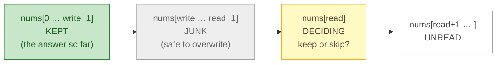
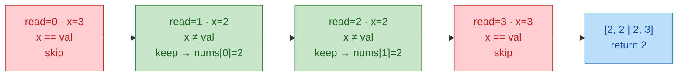
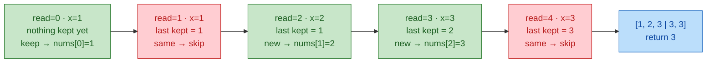
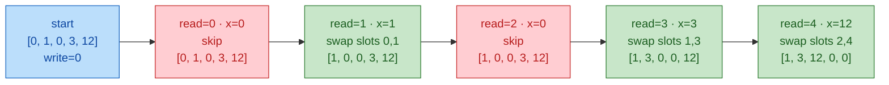
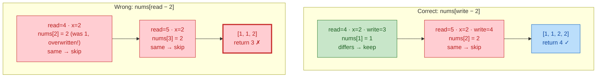

# 05. Two Pointers

Two pointers turn O(n^2) pair scans into O(n): every move **provably discards** candidates. Use them for sorted arrays, O(1)-space in-place rewrites, partitioning, merging, palindromes, 3Sum-style problems, and O(1)-space versions of hash-map solutions.

Companion code: `code/05_two_pointers.py`.

## At a glance

- **Use when:** sorted input with a pair/tuple relation; in-place rewrite with O(1) space; partition, merge, or palindrome; read-only `1..n` duplicate.
- **Templates:**
  - Template 1: Opposite ends on a sorted array, for pair sum or two-boundary area
  - Template 2: k-sum reduction, for unique triplets/quadruplets by value
  - Template 3: Same-direction read/write, for in-place filtering, "return new length"
  - Template 4: Partition / Dutch national flag, for 2–3 classes in one pass
  - Template 5: Merge two sorted sequences, for combining, intersecting, comparing
  - Template 6: Palindrome (inward pointers), for symmetry checks
  - Template 7: Fast/slow on an array (Floyd's cycle detection), for read-only duplicate in `1..n`
- **Typical complexity:** O(n) time (O(n^(k-1)) for k-sum), O(1) space.
- **Top trap:** using opposite ends on unsorted data; the discard argument depends on order.

## Core idea

Move two indices by a rule that never skips a valid answer. The geometries:

```
Opposite ends (converging)          Same direction (read/write)         Fast/slow
lo ->                <- hi          write   read ->                     slow 1 step, fast 2 steps
[1  3  4  6  8  11  15]             [1 2 3 | 3 3 4 | 4 5]               i -> nums[i] -> nums[nums[i]] ...
                                     kept    junk    unread
```

- **Opposite ends**: on a sorted array, if `nums[lo] + nums[hi] < target`, `nums[lo]` is too small with *any* index ≤ hi, so discard `lo`. Symmetric for `hi`. **Invariant: every valid pair lies within `[lo, hi]`.** Each step shrinks the range: O(n).
- **Same direction (read/write)**: `read` scans everything; `write` marks the end of the output so far. **Invariant: `nums[:write]` is the answer for `nums[:read]`.** Used for in-place filtering and compaction.
- **Partition (Dutch national flag)**: `lt`, `i`, `gt` bound three regions, each with a fixed property.
- **Merge**: one pointer per sorted sequence; advance the smaller head.
- **Fast/slow**: two speeds on an implicit linked list find a cycle and its entry (Floyd).

Always prove: "the element I leave behind cannot be in any remaining answer." If you can't, two pointers is probably wrong.

## Recognition signals

- **Sorted** input (or sortable, since you need values, not indices) and a pair/triplet with a sum/difference relation.
- "In place", "O(1) extra space", "return the new length", "relative order must be preserved" → read/write pointers.
- "Group / segregate / partition by a predicate or into 3 classes" → partition or Dutch flag.
- Two sorted inputs to combine, intersect, or compare → merge pointers.
- "Palindrome", "symmetric", "reverse" → inward pointers from both ends.
- "Maximize area/width × height between two boundaries" → opposite ends, move the limiting side.
- "n + 1 values in range 1..n", "do not modify the array", "O(1) space", find the repeated one → fast/slow cycle detection.
- n up to 10^5 (O(n^2) pairs too slow) and no space for a hash set.
- k-sum with k ≥ 3 → sort + fix elements + two pointers; O(n^(k-1)).

## Disguises

1. **Matching shift lengths.** "Two on-call engineers must together cover exactly T hours. Shift lengths are listed sorted. Find two different engineers whose lengths add up to T, using constant memory."
   Decode: sorted + pair sum + constant memory → opposite-end pointers.

2. **Packet buffer cleanup.** "A ring buffer snapshot is an array of packet IDs, sorted by ID, with retransmits. Rewrite it in place so each ID appears at most twice; report how many slots are valid."
   Decode: sorted, in place, "at most k copies", return length → read/write pointers comparing with `nums[write - k]`.

3. **Request triage.** "Requests are tagged low, normal, or urgent. In one pass and with no extra memory, rearrange the queue array: urgent first, then normal, then low."
   Decode: three classes, one pass, in place → Dutch national flag.

4. **Billboard between towers.** "Towers of known heights stand along a road at unit spacing. A banner hung between two towers is limited by the shorter one. Find the largest banner area."
   Decode: two boundaries, area = width × min height → container with most water. Move the shorter side.

5. **Corrupted inventory IDs.** "A read-only array of n + 1 serial numbers, each between 1 and n, has exactly one serial appearing more than once. Find it without modifying the array, in O(1) memory."
   Decode: read-only + O(1) space rules out sorting and hashing. In the linked list `i -> nums[i]`, the duplicate has two incoming edges, so it's a cycle entry: Floyd.

6. **Terrain flood estimate.** "A 1D elevation profile is given. After heavy rain, how much water pools in the dips?"
   Decode: water at i depends on the max on each side → trapping rain water; the side with the smaller running max knows its bound.

## Templates and worked examples

### Template 1: Opposite ends on a sorted array

> - **Example problem:** [Two Sum II - Input Array Is Sorted (167)](https://leetcode.com/problems/two-sum-ii-input-array-is-sorted/)
> - **Why this template:** Sorted array, pair with a given sum, O(1) extra space: move inward whichever pointer is provably useless.
> - **Worked below:** Example 1.1, Example 1.3 (Trapping Rain Water)
> - **Also fits:** [Container With Most Water (11)](https://leetcode.com/problems/container-with-most-water/)

```python
def opposite_ends_template(nums: list[int], target: int) -> tuple[int, int] | None:
    lo, hi = 0, len(nums) - 1
    while lo < hi:
        s = nums[lo] + nums[hi]              # TODO: the quantity (sum, area, diff)
        if s == target:                      # TODO: record/return or keep scanning
            return lo, hi
        if s < target:
            lo += 1                          # nums[lo] is too small even with the largest partner
        else:
            hi -= 1                          # nums[hi] is too large even with the smallest partner
    return None
```

Knobs: the quantity measured; which pointer moves (the provably useless one); what a hit does (return, count, or record and move both). Variants: "closest to target" (track the best difference, never return early); "count pairs with sum < target" (when `nums[lo] + nums[hi] < target`, add `hi - lo`, then `lo += 1`).

#### Example 1.1: Pair sum in a sorted array [Easy]

**Problem:** [Two Sum II - Input Array Is Sorted (167)](https://leetcode.com/problems/two-sum-ii-input-array-is-sorted/) · **Template:** Template 1 (Opposite ends on a sorted array)

**Problem.** Given a sorted array and a target, return the 1-based positions of two different entries summing to the target, in O(1) extra space.

<details>
<summary>Decode, approach, and solution</summary>

**Decode:** Sorted + pair sum + constant space → Template 1. A hash map works but wastes O(n) space and ignores sortedness.

**Approach:** Sum too small: the left value can't pair with anything (its best partner, `nums[hi]`, already fails), so advance `lo`. Too big: retreat `hi`.

```python
def two_sum_sorted(numbers: list[int], target: int) -> list[int]:
    lo, hi = 0, len(numbers) - 1
    while lo < hi:
        s = numbers[lo] + numbers[hi]
        if s == target:
            return [lo + 1, hi + 1]
        if s < target:
            lo += 1
        else:
            hi -= 1
    return []
```

**Complexity:** O(n) time (range shrinks each step), O(1) space.

**Edge cases:** `lo < hi`, not `<=`. Negatives are fine. 1-based output.

</details>

#### Example 1.2: Largest container [Medium]

**Problem:** [Container With Most Water (11)](https://leetcode.com/problems/container-with-most-water/) · **Template:** Template 1 (Opposite ends on a sorted array)

**Problem.** Vertical lines at unit spacing have given heights. Return the most water two lines can hold with the x-axis.

<details>
<summary>Decode, approach, and solution</summary>

**Decode:** Two boundaries, area = width × min(height) → opposite ends (brute force is O(n^2)).

**Approach:** Start widest. The shorter wall limits the area; any closer partner reduces width without raising that limit, so discard the shorter wall.

```python
def max_area(heights: list[int]) -> int:
    lo, hi = 0, len(heights) - 1
    best = 0
    while lo < hi:
        h = min(heights[lo], heights[hi])
        best = max(best, h * (hi - lo))
        if heights[lo] < heights[hi]:
            lo += 1
        else:
            hi -= 1
    return best
```

**Complexity:** O(n) time, O(1) space.

**Edge cases:** Equal heights: move either (same bound, smaller width). Fewer than 2 lines → 0.

</details>

#### Example 1.3: Water trapped in an elevation map [Hard]

**Problem:** [Trapping Rain Water (42)](https://leetcode.com/problems/trapping-rain-water/) · **Template:** Template 1 (Opposite ends on a sorted array), with running maxima

**Problem.** Given non-negative bar heights of width 1, compute how much rain water they trap.

<details>
<summary>Decode, approach, and solution</summary>

**Decode:** Water at `i` = `min(max left of i, max right of i) - height[i]`. The prefix/suffix-max version (module 04, Template 9) uses O(n) space; two pointers use O(1).

**Approach:** Keep `left_max` over `heights[0..lo]` and `right_max` over `heights[hi..]`. If `heights[lo] < heights[hi]`, some right wall is at least `left_max` (`heights[hi]`, or an earlier one that made us move `hi`), so the bound at `lo` is the known `left_max`. Settle `lo` and advance; otherwise settle `hi` symmetrically.

```python
def trap(heights: list[int]) -> int:
    lo, hi = 0, len(heights) - 1
    left_max = right_max = 0
    water = 0
    while lo < hi:
        if heights[lo] < heights[hi]:
            left_max = max(left_max, heights[lo])
            water += left_max - heights[lo]  # a right wall >= left_max exists: left_max binds
            lo += 1
        else:
            right_max = max(right_max, heights[hi])
            water += right_max - heights[hi]
            hi -= 1
    return water
```

**Complexity:** O(n) time, O(1) space.

**Edge cases:** Fewer than 3 bars or a monotonic profile → 0. Updating `left_max` before adding keeps contributions non-negative. A monotonic stack (module 08) computes water by layers instead of columns.

</details>

### Template 2: k-sum reduction

> - **Example problem:** [3Sum (15)](https://leetcode.com/problems/3sum/)
> - **Why this template:** "All unique triplets" summing to zero (values, not indices): sort, fix one element, run two-pointer pair sum on the rest.
> - **Worked below:** Example 2.1
> - **Also fits:** [4Sum (18)](https://leetcode.com/problems/4sum/)

```python
def k_sum_template(nums: list[int], target: int, k: int) -> list[list[int]]:
    nums = sorted(nums)

    def k_sum(start: int, k: int, target: int) -> list[list[int]]:
        res: list[list[int]] = []
        if k == 2:
            lo, hi = start, len(nums) - 1
            while lo < hi:
                s = nums[lo] + nums[hi]
                if s < target:
                    lo += 1
                elif s > target:
                    hi -= 1
                else:
                    res.append([nums[lo], nums[hi]])
                    lo += 1
                    hi -= 1
                    while lo < hi and nums[lo] == nums[lo - 1]:
                        lo += 1              # skip duplicate left values
            return res
        for i in range(start, len(nums) - k + 1):
            if i > start and nums[i] == nums[i - 1]:
                continue                     # same first value -> same results
            for rest in k_sum(i + 1, k - 1, target - nums[i]):
                res.append([nums[i]] + rest)
        return res

    return k_sum(0, k, target)
```

Knobs: k; dedup (skip values equal to the **previous index at the same level**: `i > start`, not `i > 0`); pruning (break once the smallest possible sum exceeds the target). Cost: O(n^(k-1)) plus O(n log n) to sort.

#### Example 2.1: Zero-sum triplets [Medium]

**Problem:** [3Sum (15)](https://leetcode.com/problems/3sum/) · **Template:** Template 2 (k-sum reduction)

**Problem.** Return all unique triplets of values (not indices) that sum to zero.

<details>
<summary>Decode, approach, and solution</summary>

**Decode:** Unique value triplets → sort, fix one, two-pointer 2-sum on the rest. Hash sets make dedup painful.

**Approach:** Sort. For each `i`, find pairs in `nums[i+1:]` summing to `-nums[i]`. Dedup at both levels: skip `i` equal to `nums[i-1]`; after a hit, skip `lo` past equal values (`hi` follows from the sum logic). Break once `nums[i] > 0`.

```python
def three_sum(nums: list[int]) -> list[list[int]]:
    nums = sorted(nums)
    n = len(nums)
    res: list[list[int]] = []
    for i in range(n - 2):
        if nums[i] > 0:
            break                            # smallest is positive -> no zero sum
        if i > 0 and nums[i] == nums[i - 1]:
            continue                         # dedup the fixed element
        lo, hi = i + 1, n - 1
        while lo < hi:
            s = nums[i] + nums[lo] + nums[hi]
            if s < 0:
                lo += 1
            elif s > 0:
                hi -= 1
            else:
                res.append([nums[i], nums[lo], nums[hi]])
                lo += 1
                hi -= 1
                while lo < hi and nums[lo] == nums[lo - 1]:
                    lo += 1                  # dedup the second element
    return res
```

**Complexity:** O(n^2) time (n fixed elements × O(n) scan; the sort is dominated), O(1) extra besides output and the sort's buffer.

**Edge cases:** All zeros → one triplet `[0, 0, 0]`. Fewer than 3 elements → empty. Variants: 3Sum Closest (track min `|s - target|`), 4Sum (one more fixed level), count triplets with sum < target (add `hi - lo` per step).

</details>

### Template 3: Same-direction read/write

> - **Example problem:** [Remove Duplicates from Sorted Array II (80)](https://leetcode.com/problems/remove-duplicates-from-sorted-array-ii/)
> - **Why this template:** Sorted array, "in place", "return the new length": a write pointer trails the read pointer, keeping allowed elements.
> - **Worked below:** Example 3.1
> - **Also fits:** [Move Zeroes (283)](https://leetcode.com/problems/move-zeroes/)

```python
def read_write_template(nums: list[int]) -> int:
    write = 0
    for read in range(len(nums)):
        if nums[read] != 0:                  # TODO: keep condition (may look at nums[write-1])
            nums[write] = nums[read]
            write += 1
    return write                             # new logical length
```

Knobs: the keep condition.

| Problem | Keep `nums[read]` if |
|---|---|
| Remove element `val` | `nums[read] != val` |
| Remove duplicates (sorted) | `write == 0 or nums[write - 1] != nums[read]` |
| At most k copies (sorted) | `write < k or nums[write - k] != nums[read]` |
| Move zeroes | non-zero; swap instead of overwriting so zeros collect at the tail |

Compare against the **kept** prefix (`nums[write - k]`), not `nums[read - k]`, which may be overwritten or discarded.

**Seeing the knobs.** At every step the array has four zones. `read` always moves; `write` moves only on a keep. Only the keep condition changes between variants.



In the traces below, green = keep (copy `x` to `nums[write]`, then `write += 1`), red = skip (only `read` moves).

**Knob 1: remove a value.** Look only at `x`. `nums = [3, 2, 2, 3]`, `val = 3`:


Everything after `|` is leftover junk; the caller reads only the first `write` slots.

**Knob 2: remove duplicates (k = 1).** Compare `x` with the **last kept** value, `nums[write - 1]`. `nums = [1, 1, 2, 3, 3]`:



**Knob 3: at most k copies (k = 2).** Look **k slots back** in the kept prefix, at `nums[write - 2]`. The array is sorted, so if that value equals `x`, the last 2 kept values are both `x` and `x` would be a third copy. `nums = [1, 1, 1, 2, 2, 3]`:

```mermaid
flowchart LR
    r0["read=0 · x=1<br/>fewer than 2 kept<br/>keep → nums[0]=1"]:::good --> r1["read=1 · x=1<br/>fewer than 2 kept<br/>keep → nums[1]=1"]:::good --> r2["read=2 · x=1<br/>2 back = nums[0] = 1<br/>same → skip"]:::bad --> r3["read=3 · x=2<br/>2 back = nums[0] = 1<br/>differs → nums[2]=2"]:::good --> r4["read=4 · x=2<br/>2 back = nums[1] = 1<br/>differs → nums[3]=2"]:::good --> r5["read=5 · x=3<br/>2 back = nums[2] = 2<br/>differs → nums[4]=3"]:::good --> res["[1, 1, 2, 2, 3 | 3]<br/>return 5"]:::done
    classDef good fill:#c8e6c9,stroke:#2e7d32,color:#1b5e20
    classDef bad fill:#ffcdd2,stroke:#c62828,color:#b71c1c
    classDef done fill:#bbdefb,stroke:#1565c0,color:#0d47a1
```


Knob 2 is just Knob 3 with k = 1: "1 back" is the last kept value.

**Knob 4: move zeroes (swap, don't overwrite).** Same keep condition as Knob 1 (`x != 0`), but **swap** `nums[write]` and `nums[read]`. The junk zone holds only zeros, so each swap pushes a zero toward the tail. `nums = [0, 1, 0, 3, 12]`:


Overwriting instead would leave `[1, 3, 12, 3, 12]`: correct prefix, but the tail is junk, not zeros.

**Pitfall: why `nums[write - k]`, not `nums[read - k]`.** By the time `read` gets there, a slot behind it may already hold a new value. `nums = [1, 1, 1, 2, 2, 2]`, k = 2, after the first four steps the array is `[1, 1, 2, 2, 2, 2]` (slot 2 was overwritten with a 2):


`write` only ever points into the kept prefix, which never changes once written, so `nums[write - k]` always means "k kept values back."

#### Example 3.1: Keep at most k copies [Medium]

**Problem:** [Remove Duplicates from Sorted Array II (80)](https://leetcode.com/problems/remove-duplicates-from-sorted-array-ii/) · **Template:** Template 3 (Same-direction read/write)

**Problem.** In a sorted array, remove extra duplicates in place so each value appears at most twice. Return the new length; the first `length` slots hold the result.

<details>
<summary>Decode, approach, and solution</summary>

**Decode:** Sorted + in place + return length → read/write pointers. "At most twice" generalizes to k.

**Approach:** `nums[:write]` is the valid output so far. Because the array is sorted, `x` is a (k+1)-th copy exactly when `nums[write - k] == x`; otherwise keep it.

```python
def remove_duplicates_keep_k(nums: list[int], k: int = 2) -> int:
    write = 0
    for x in nums:
        if write < k or nums[write - k] != x:
            nums[write] = x
            write += 1
    return write
```

**Complexity:** O(n) time, O(1) space.

**Edge cases:** `k = 1` is classic "remove duplicates". Empty → 0. Writing during `for x in nums` is safe: `write <= read`, so no unread element is overwritten. Related: Move Zeroes swaps so the tail fills with zeros:

```python
def move_zeroes(nums: list[int]) -> None:
    write = 0
    for read in range(len(nums)):
        if nums[read] != 0:
            nums[write], nums[read] = nums[read], nums[write]
            write += 1
```

</details>

### Template 4: Partition / Dutch national flag

> - **Example problem:** [Sort Colors (75)](https://leetcode.com/problems/sort-colors/)
> - **Why this template:** Three classes (0, 1, 2), in place, one pass: maintain < / == / unknown / > regions around pivot 1.
> - **Worked below:** Example 4.1

```python
def dutch_flag_template(nums: list[int], pivot: int) -> None:
    lt, i, gt = 0, 0, len(nums) - 1
    while i <= gt:
        if nums[i] < pivot:
            nums[lt], nums[i] = nums[i], nums[lt]
            lt += 1
            i += 1                           # swapped-in value came from the == region
        elif nums[i] > pivot:
            nums[i], nums[gt] = nums[gt], nums[i]
            gt -= 1                          # do NOT advance i: swapped-in value is unknown
        else:
            i += 1
```

```
[ < pivot | == pivot | unknown | > pivot ]
 0        lt         i        gt         n
```

Knobs: the classification (pivot comparison, color, parity, predicate). Two-way partitioning (even/odd, Lomuto) uses one boundary. This is also quickselect's partition step (module 11) and three-way quicksort's.

#### Example 4.1: Three-way partition [Medium]

**Problem:** [Sort Colors (75)](https://leetcode.com/problems/sort-colors/) · **Template:** Template 4 (Partition / Dutch national flag)

**Problem.** Sort an array of only 0, 1, 2 in place, in one pass, with O(1) space.

<details>
<summary>Decode, approach, and solution</summary>

**Decode:** Three classes + one pass + in place → Dutch national flag with pivot 1. (Mention counting sort: two passes.)

**Approach:** Maintain `[0, lt)` = 0s, `[lt, i)` = 1s, `[i, gt]` = unknown, `(gt, n)` = 2s. A 0 swaps to `lt` (a 1 comes back: advance `i`). A 2 swaps to `gt` (an unknown comes back: don't advance).

```python
def sort_colors(nums: list[int]) -> None:
    lt, i, gt = 0, 0, len(nums) - 1
    while i <= gt:
        if nums[i] == 0:
            nums[lt], nums[i] = nums[i], nums[lt]
            lt += 1
            i += 1
        elif nums[i] == 2:
            nums[i], nums[gt] = nums[gt], nums[i]
            gt -= 1
        else:
            i += 1
```

**Complexity:** O(n) time (each iteration advances `i` or shrinks `gt`), O(1) space.

**Edge cases:** Loop on `i <= gt` (the element at `gt` is still unknown). Empty and single-element arrays work.

</details>

### Template 5: Merge two sorted sequences

> - **Example problem:** [Merge Sorted Array (88)](https://leetcode.com/problems/merge-sorted-array/)
> - **Why this template:** Merge two sorted arrays: advance the pointer with the smaller head (from the back, since the buffer is at the end of `nums1`).
> - **Worked below:** Example 5.1

```python
def merge_template(a: list[int], b: list[int]) -> list[int]:
    i = j = 0
    out: list[int] = []
    while i < len(a) and j < len(b):
        if a[i] <= b[j]:                     # TODO: compare rule / emit rule (intersection, union)
            out.append(a[i]); i += 1
        else:
            out.append(b[j]); j += 1
    out.extend(a[i:])
    out.extend(b[j:])
    return out
```

Knobs: what to emit. Intersection: emit when equal, advance both. Difference: emit from `a` when `a[i] < b[j]`. In place into a buffer at the end of `a`: fill **from the back** (Example 5.1). Is-subsequence: advance `i` only on match, always advance `j`.

#### Example 5.1: Merge into the buffer at the end of the first array [Easy]

**Problem:** [Merge Sorted Array (88)](https://leetcode.com/problems/merge-sorted-array/) · **Template:** Template 5 (Merge two sorted sequences)

**Problem.** `nums1` holds `m` sorted values followed by `n` empty slots; `nums2` holds `n` sorted values. Merge `nums2` into `nums1` in place so all `m + n` are sorted. Example: `[1, 2, 3, 0, 0, 0], m = 3, [2, 5, 6], n = 3` → `[1, 2, 2, 3, 5, 6]`.

<details>
<summary>Decode, approach, and solution</summary>

**Decode:** Two sorted sequences + one output → merge. In place with the free space at the end → fill from the back.

**Approach:** Merging from the front would overwrite unread `nums1` values. From the back, write the larger of the two tails into `nums1[w]`. Invariant: `w = i + j + 1`, so `w > i` while `nums2` has values left; the write slot never holds an unread `nums1` value.

```python
def merge_sorted_in_place(nums1: list[int], m: int, nums2: list[int], n: int) -> None:
    i, j, w = m - 1, n - 1, m + n - 1
    while j >= 0:
        if i >= 0 and nums1[i] > nums2[j]:
            nums1[w] = nums1[i]
            i -= 1
        else:
            nums1[w] = nums2[j]
            j -= 1
        w -= 1
```

**Complexity:** O(m + n) time (one write per step), O(1) extra space.

**Edge cases:** Loop on `j >= 0` only: once `nums2` is exhausted, `nums1`'s remainder is already in place. `m = 0` copies `nums2`; `n = 0` does nothing. Ties take `nums2` (either is fine).

</details>

### Template 6: Palindrome (inward pointers)

> - **Example problem:** [Valid Palindrome (125)](https://leetcode.com/problems/valid-palindrome/)
> - **Why this template:** "Reads the same forward and backward" after skipping non-alphanumerics: compare characters moving inward.
> - **Worked below:** Example 6.1
> - **Also fits:** [Valid Palindrome II (680)](https://leetcode.com/problems/valid-palindrome-ii/)

```python
def is_palindrome_range(s: str, lo: int, hi: int) -> bool:
    while lo < hi:
        if s[lo] != s[hi]:
            return False
        lo += 1
        hi -= 1
    return True
```

Knobs: what to skip (non-alphanumerics), normalization (case), and mismatches allowed (one deletion: Example 6.1). Pass `(lo, hi)` instead of slicing to avoid O(n) copies. Expand-around-center (longest palindromic substring) is the outward version.

#### Example 6.1: Palindrome after at most one deletion [Easy]

**Problem:** [Valid Palindrome II (680)](https://leetcode.com/problems/valid-palindrome-ii/) · **Template:** Template 6 (Palindrome (inward pointers))

**Problem.** Return whether a string can become a palindrome by deleting at most one character. Example: `"abca"` → `true` (delete `b` or `c`); `"abc"` → `false`.

<details>
<summary>Decode, approach, and solution</summary>

**Decode:** "Palindrome" → inward pointers. "At most one deletion" → one allowed mismatch. Trying every deletion is O(n^2).

**Approach:** Move inward while ends match; matched pairs never need deleting. At the first mismatch, one of `s[lo]` and `s[hi]` must go, so the answer is whether `s[lo+1..hi]` or `s[lo..hi-1]` is a palindrome (`is_palindrome_range`). Both must be tried: `"deeee"` needs the left skip, `"cbbcc"` the right.

```python
def valid_palindrome_one_delete(s: str) -> bool:
    lo, hi = 0, len(s) - 1
    while lo < hi:
        if s[lo] != s[hi]:
            return is_palindrome_range(s, lo + 1, hi) or is_palindrome_range(s, lo, hi - 1)
        lo += 1
        hi -= 1
    return True
```

**Complexity:** O(n) time (the outer scan plus at most two range checks, each O(n)), O(1) space (indices, no slicing).

**Edge cases:** Already a palindrome → `true` with no deletion. Length 0–2 → `true`. Only the first mismatch branches; the range checks allow no further deletions. Allowing k deletions (Valid Palindrome III) needs DP instead.

</details>

### Template 7: Fast/slow on an array (Floyd's cycle detection)

> - **Example problem:** [Find the Duplicate Number (287)](https://leetcode.com/problems/find-the-duplicate-number/)
> - **Why this template:** n + 1 values in `1..n`, read-only, O(1) space: `i -> nums[i]` forms a linked structure whose cycle entry is the duplicate.
> - **Worked below:** Example 7.1

```python
def floyd_on_array_template(nums: list[int]) -> int:
    slow = fast = nums[0]                    # TODO: start node and 'next' function
    while True:
        slow = nums[slow]
        fast = nums[nums[fast]]
        if slow == fast:
            break
    slow = nums[0]
    while slow != fast:
        slow = nums[slow]
        fast = nums[fast]
    return slow
```

Why phase 2 works: let `F` = distance from start to cycle entry, `C` = cycle length. At the meeting point slow has walked `F + a`, fast `2(F + a)`, so `F + a` is a multiple of C. So `F` more steps from the meeting point reach the entry, as do `F` steps from the start. Knob: the `next` function (`nums[i]`, sum of squared digits for Happy Number, `node.next` for linked lists in module 09).

#### Example 7.1: Repeated value in a read-only array [Medium]

**Problem:** [Find the Duplicate Number (287)](https://leetcode.com/problems/find-the-duplicate-number/) · **Template:** Template 7 (Fast/slow on an array (Floyd's cycle detection))

**Problem.** An array of n + 1 integers in `1..n` has exactly one repeated value (possibly repeated many times). Find it without modifying the array, in O(1) extra space.

<details>
<summary>Decode, approach, and solution</summary>

**Decode:** Sorting and cyclic sort modify; a set uses O(n). Every value is a valid index, so `i -> nums[i]` is a function on indices. Nothing points to index 0, so walking from 0 must enter a cycle. The duplicate has two incoming edges, so it is the cycle entry.

**Approach:** Floyd: phase 1 finds a meeting point in the cycle; phase 2 restarts one pointer at the start and steps both by one until they meet at the entry.

```python
def find_duplicate(nums: list[int]) -> int:
    slow = fast = nums[0]
    while True:
        slow = nums[slow]
        fast = nums[nums[fast]]
        if slow == fast:
            break
    slow = nums[0]
    while slow != fast:
        slow = nums[slow]
        fast = nums[fast]
    return slow
```

**Complexity:** O(n) time, O(1) space.

**Edge cases:** Works when the value repeats more than twice (`[2, 2, 2, 2, 2]`). Alternative under the same constraints: binary search on the value with pigeonhole counting, O(n log n).

</details>

## Template cheat sheet

Every template from this module in one place, for warm-ups and review.

### Template 1: Opposite ends on a sorted array

```python
def opposite_ends_template(nums: list[int], target: int) -> tuple[int, int] | None:
    lo, hi = 0, len(nums) - 1
    while lo < hi:
        s = nums[lo] + nums[hi]              # TODO: the quantity (sum, area, diff)
        if s == target:                      # TODO: record/return or keep scanning
            return lo, hi
        if s < target:
            lo += 1                          # nums[lo] is too small even with the largest partner
        else:
            hi -= 1                          # nums[hi] is too large even with the smallest partner
    return None
```

### Template 2: k-sum reduction

```python
def k_sum_template(nums: list[int], target: int, k: int) -> list[list[int]]:
    nums = sorted(nums)

    def k_sum(start: int, k: int, target: int) -> list[list[int]]:
        res: list[list[int]] = []
        if k == 2:
            lo, hi = start, len(nums) - 1
            while lo < hi:
                s = nums[lo] + nums[hi]
                if s < target:
                    lo += 1
                elif s > target:
                    hi -= 1
                else:
                    res.append([nums[lo], nums[hi]])
                    lo += 1
                    hi -= 1
                    while lo < hi and nums[lo] == nums[lo - 1]:
                        lo += 1              # skip duplicate left values
            return res
        for i in range(start, len(nums) - k + 1):
            if i > start and nums[i] == nums[i - 1]:
                continue                     # same first value -> same results
            for rest in k_sum(i + 1, k - 1, target - nums[i]):
                res.append([nums[i]] + rest)
        return res

    return k_sum(0, k, target)
```

### Template 3: Same-direction read/write

```python
def read_write_template(nums: list[int]) -> int:
    write = 0
    for read in range(len(nums)):
        if nums[read] != 0:                  # TODO: keep condition (may look at nums[write-1])
            nums[write] = nums[read]
            write += 1
    return write                             # new logical length
```

### Template 4: Partition / Dutch national flag

```python
def dutch_flag_template(nums: list[int], pivot: int) -> None:
    lt, i, gt = 0, 0, len(nums) - 1
    while i <= gt:
        if nums[i] < pivot:
            nums[lt], nums[i] = nums[i], nums[lt]
            lt += 1
            i += 1                           # swapped-in value came from the == region
        elif nums[i] > pivot:
            nums[i], nums[gt] = nums[gt], nums[i]
            gt -= 1                          # do NOT advance i: swapped-in value is unknown
        else:
            i += 1
```

### Template 5: Merge two sorted sequences

```python
def merge_template(a: list[int], b: list[int]) -> list[int]:
    i = j = 0
    out: list[int] = []
    while i < len(a) and j < len(b):
        if a[i] <= b[j]:                     # TODO: compare rule / emit rule (intersection, union)
            out.append(a[i]); i += 1
        else:
            out.append(b[j]); j += 1
    out.extend(a[i:])
    out.extend(b[j:])
    return out
```

### Template 6: Palindrome (inward pointers)

```python
def is_palindrome_range(s: str, lo: int, hi: int) -> bool:
    while lo < hi:
        if s[lo] != s[hi]:
            return False
        lo += 1
        hi -= 1
    return True
```

### Template 7: Fast/slow on an array (Floyd's cycle detection)

```python
def floyd_on_array_template(nums: list[int]) -> int:
    slow = fast = nums[0]                    # TODO: start node and 'next' function
    while True:
        slow = nums[slow]
        fast = nums[nums[fast]]
        if slow == fast:
            break
    slow = nums[0]
    while slow != fast:
        slow = nums[slow]
        fast = nums[fast]
    return slow
```

## Variations and extensions

- **Squares of a sorted array**: the largest squares are at the ends; fill the output from the back (`sorted_squares` in the companion file).
- **Valid palindrome with one deletion**: see Example 6.1.
- **Count pairs**: sum < target, or valid triangle number (sort, fix the largest side, two pointers on the rest, add `hi - lo` at once).
- **Boats / pairing greedy** (Boats to Save People): sort; pair heaviest with lightest if they fit.
- **Two pointers on linked lists**: middle node, k-th from end, cycle entry (module 09).
- **Interviewer follow-ups**:
  - Not sorted? Sort (O(n log n)) if indices aren't needed; else hash map.
  - Duplicates? Skip equal neighbors at every level of k-sum.
  - One pass / O(1) space? Dutch flag, Floyd, two-pointer trap.
  - Stream / two huge sorted files? Merge pointers run on iterators in O(1) memory (external merge sort).
  - General k-sum? Template 2 recursion, O(n^(k-1)); for k = 4, a pair-sum hash gives O(n^2) average but harder dedup.

## Common pitfalls

- Opposite-end pointers on **unsorted** data: the discard argument depends on order.
- `while lo <= hi` in pair problems pairs an element with itself. Use `lo < hi`.
- 3Sum dedup with `i > 0` inside a general k-sum recursion: must be `i > start`, or deeper levels skip valid combinations.
- After a 3Sum hit, moving only one pointer, or skipping duplicates on the wrong side of the bounds check (`nums[lo] == nums[lo - 1]` must be guarded by `lo < hi`).
- Dutch flag: advancing `i` after swapping with `gt`, or using `i < gt` instead of `i <= gt`.
- Read/write: comparing with `nums[read - 1]` instead of the kept prefix `nums[write - 1]` / `nums[write - k]`.
- In-place merge from the front overwrites unread `nums1` elements. Merge from the back.
- Floyd: starting `fast` one step ahead in phase 1 without adjusting phase 2. Start both at the same node.
- Container: moving the taller wall. Move the shorter (it can't improve).
- Returning original indices after sorting (they're gone). Sort `(value, index)` pairs or use a hash map.

## When NOT to use / look-alikes

| Look-alike | How to tell | Use |
|---|---|---|
| **Sliding window** (06) | Answer is a **contiguous** subarray/substring constrained by its contents ("longest with at most k distinct"). Both pointers move forward; the window content is the state. | Window + counter/sum |
| **Two pointers (this module)** | Answer is a **pair/tuple of positions** (often not contiguous) or an in-place rewrite. Pointers converge, or one reads and one writes. Window content isn't the state. | Pointers + sortedness or a keep predicate |
| **Hash map** (04) | Unsorted input, need original indices, O(n) space fine. | Complement lookup |
| **Prefix sum + hash** (04) | Subarray sum = k with negatives, or subarray counts. Two pointers have no valid discard rule. | Prefix + map |
| **Binary search** (07) | Searching a partner per element in a sorted array: O(n log n). Two pointers do it in O(n) when both sides move monotonically. | Use binary search when only one side is sorted or queries are independent |
| **Monotonic stack** (08) | "Next greater element", or water/area problems where you need the nearest taller bar, not the global max. | Stack |
| **Sorting + greedy** (18) | Optimal pairing; two pointers often just implement the greedy. | Prove the greedy, then use pointers |

Rule of thumb: "what is between the pointers?" → sliding window. "What are the values at the pointers?" → two pointers.

## Practice ladder

Track your progress in [`practice-tracker.md`](practice-tracker.md).

### Must-do

1. [Two Sum II - Input Array Is Sorted (167)](https://leetcode.com/problems/two-sum-ii-input-array-is-sorted/) · Medium · Opposite ends: discard the useless end.
2. [3Sum (15)](https://leetcode.com/problems/3sum/) · Medium · k-sum + dedup: sort, fix one, dedup at both levels.
3. [Container With Most Water (11)](https://leetcode.com/problems/container-with-most-water/) · Medium · Opposite ends: move the shorter wall.
4. [Sort Colors (75)](https://leetcode.com/problems/sort-colors/) · Medium · Dutch national flag: three regions, do not advance after the right swap.
5. [Trapping Rain Water (42)](https://leetcode.com/problems/trapping-rain-water/) · Hard · Two pointers with running maxima: settle the side with the smaller max.

### Optional

**Opposite ends**
- [Valid Palindrome (125)](https://leetcode.com/problems/valid-palindrome/) · Easy · Skip non-alphanumerics, compare lowercase.
- [Squares of a Sorted Array (977)](https://leetcode.com/problems/squares-of-a-sorted-array/) · Easy · Biggest squares at the ends, fill from the back.
- [Valid Palindrome II (680)](https://leetcode.com/problems/valid-palindrome-ii/) · Easy · On mismatch try skipping each side.
- [Boats to Save People (881)](https://leetcode.com/problems/boats-to-save-people/) · Medium · Heaviest with lightest if they fit.
- [Rotate Array (189)](https://leetcode.com/problems/rotate-array/) · Medium · Reverse trick: reverse all, then reverse the first k and the rest.
- [Next Permutation (31)](https://leetcode.com/problems/next-permutation/) · Medium · Find the rightmost ascent, swap with the next larger value from the right, reverse the suffix.

**k-sum**
- [3Sum Closest (16)](https://leetcode.com/problems/3sum-closest/) · Medium · Track best absolute difference.
- [4Sum (18)](https://leetcode.com/problems/4sum/) · Medium · One more fixed level; watch `i > start`.
- [Valid Triangle Number (611)](https://leetcode.com/problems/valid-triangle-number/) · Medium · Fix the largest side, count `hi - lo` at once.

**Read/write**
- [Remove Duplicates from Sorted Array (26)](https://leetcode.com/problems/remove-duplicates-from-sorted-array/) · Easy · Compare with last kept.
- [Remove Element (27)](https://leetcode.com/problems/remove-element/) · Easy · Keep if not equal to val.
- [Move Zeroes (283)](https://leetcode.com/problems/move-zeroes/) · Easy · Swap to preserve order and push zeros back.
- [Backspace String Compare (844)](https://leetcode.com/problems/backspace-string-compare/) · Easy · Read/write each string, or scan both from the back counting pending skips for O(1) space.
- [Remove Duplicates from Sorted Array II (80)](https://leetcode.com/problems/remove-duplicates-from-sorted-array-ii/) · Medium · Compare with `nums[write - 2]`.

**Partition**
- [Sort Array By Parity (905)](https://leetcode.com/problems/sort-array-by-parity/) · Easy · Two-way partition.

**Merge**
- [Merge Sorted Array (88)](https://leetcode.com/problems/merge-sorted-array/) · Easy · Fill from the back.
- [Is Subsequence (392)](https://leetcode.com/problems/is-subsequence/) · Easy · Advance the pattern pointer only on match.

**Fast/slow and two-sided bounds**
- [Find the Duplicate Number (287)](https://leetcode.com/problems/find-the-duplicate-number/) · Medium · Array as linked list, Floyd.

## Self-check

1. State the opposite-end invariant for pair sum, and prove that moving `lo` when the sum is too small never loses an answer.
2. In Container With Most Water, why is it safe to discard the shorter wall? What happens with equal heights?
3. In the Dutch flag, why advance `i` after swapping with `lt` but not with `gt`?
4. For "at most k copies" compaction, why compare with `nums[write - k]` and not `nums[read - k]`?
5. Why must 3Sum dedup skip values equal to the previous one at the same level (`i > start`)? What breaks with `i > 0` in a recursive k-sum?
6. In Find the Duplicate Number, why is the duplicate the entry of a cycle, and why does restarting one pointer from the start find it?
7. In two-pointer Trapping Rain Water, why is `left_max` the bound at `lo` when `heights[lo] < heights[hi]`, though you haven't seen the true right max?
