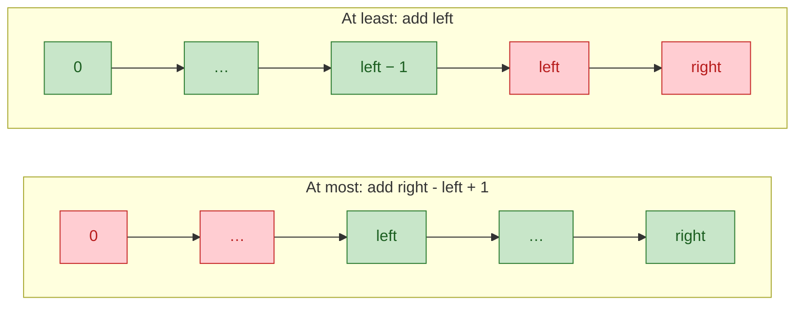
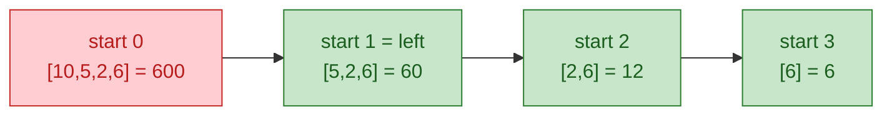
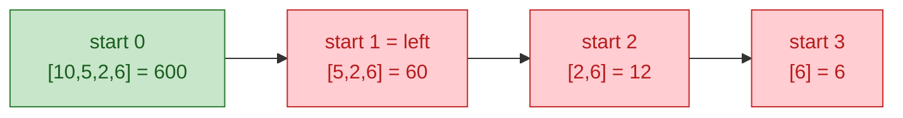
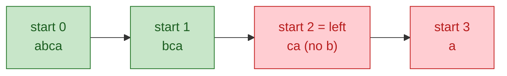
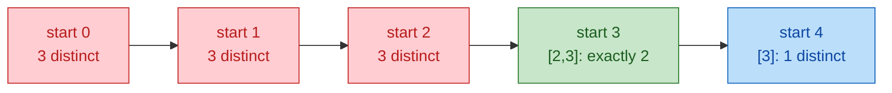

# 06. Sliding Window

Sliding window cuts "examine every contiguous subarray/substring" from O(n^2) or O(n^3) to O(n) by updating a running summary of one window as its edges move. It covers longest/shortest/count of constrained contiguous segments, fixed-length scans, and (with a monotonic deque) running max/min. Interviewers love it: the code is short, the correctness argument subtle.

## At a glance

- **Use when:** contiguous subarray/substring + longest/shortest/count, under a constraint that survives shrinking (or growing); "every window of size k".
- **Templates:**
  - Template 1: fixed-size window, for every window of length k with invertible state
  - Template 2: variable window, longest valid, when shrinking preserves validity
  - Template 3: variable window, shortest valid, when growing preserves validity
  - Template 4: count subarrays with "at most K" (and exactly K), for counting; exactly = atMost(K) − atMost(K−1)
  - Template 5: monotonic deque for window max/min, when the state is a max or min (deep dive: `06a-monotonic-deques.md`)
- **Typical complexity:** O(n) time, O(1) to O(σ) or O(k) space.
- **Top trap:** using a window when validity is not monotonic (negatives with sum targets, "exactly K"). What to use instead: `06b-beyond-sliding-window.md`.

## Core idea

Maintain a window `[left, right]` and a **state** summarizing it (sum, Counter, distinct count, max via deque). Each step advances `right` by one and `left` by zero or more. Both only move forward, so total work is O(n) amortized.

```
 index:  0  1  2  3  4  5  6
        [2, 3, 1, 2, 4, 3]
            L--------R          state = sum(nums[L..R])
 step:   R += 1  -> add nums[R]
         while (window violates / satisfies condition): remove nums[L], L += 1
```

**The invariant that makes it correct: monotonic validity.** For a fixed `right`, valid `left` values must form a contiguous range that only moves right as `right` grows. One of these must hold:

| Property | Meaning | Problem type |
|---|---|---|
| Shrinking preserves validity | If `[l, r]` is valid, so is `[l+1, r]` | "longest such that", "count at most" |
| Growing preserves validity | If `[l, r]` is valid, so is `[l-1, r]` and `[l, r+1]` | "shortest such that" |

Why: when the window turns invalid, we advance `left` and **never move it back**, which is safe only if no smaller `left` becomes valid again for a larger `right`. With monotonic validity (longest case), `[l, r]` invalid implies `[l, r+1]` invalid, so discarding `l` forever is correct.

**Why it breaks with negatives for sum targets.** "Sum ≤ K" is monotonic only if adding an element never decreases the sum. With negatives, `[l, r]` can exceed K while `[l, r+1]` is back under, so a discarded `left` might have been in the answer. For "sum ≥ K, shortest", dropping a negative from the left *raises* the sum, so shrinking doesn't reliably head toward invalid. Use prefix sums + hash map (count/exists) or prefix sums + monotonic deque (shortest); see `04-arrays-hashing-prefix-sums.md`. **Deep dive:** [`06b-beyond-sliding-window.md`](06b-beyond-sliding-window.md) covers every fallback (hash map, Kadane, prefix deque/stack, sorted prefixes, Fenwick counting, binary search on the answer) with worked examples.

## Recognition signals

- "Contiguous subarray" / "substring" (not subsequence) + "longest", "shortest", "maximum", "minimum", or "number of".
- A monotonic window constraint: "at most K distinct", "no repeats", "sum ≤ / ≥ target with non-negative values", "at most K zeros/flips", "contains all characters of t".
- "Every window of size k", "any k consecutive", "rolling", "last k events": fixed window.
- n up to 10^5–10^6: expect O(n) or O(n log n).
- "Exactly K" of something countable (distinct values, odd numbers, ones): convert to atMost(K) − atMost(K−1).
- "Max/min of each window": monotonic deque.
- "Anagram / permutation of p appears in s": fixed window of length len(p) with Counter.

## Disguises

1. **Log burst detector.** "Given per-second request counts, find the longest stretch whose total stayed within the rate-limit budget B."
   Decode: non-negative counts, longest window with sum ≤ B: longest-window template.

2. **Fruit basket.** "A robot walks a row of trees, picking one fruit per tree, and can carry only two fruit types. Starting anywhere, how many fruits can it pick before stopping?"
   Decode: walking a row is contiguous; two types means at most 2 distinct. Longest window with Counter state (LeetCode: Fruit Into Baskets).

3. **Deploy freeze audit.** "An array marks each minute healthy (1) or failing (0). You may silence up to k failing minutes. What's the longest healthy run you can report?"
   Decode: "longest run with at most k zeros" (LeetCode: Max Consecutive Ones III). The flips are a window budget, not actual edits.

4. **Nice subarrays.** "Count the contiguous segments of a job list that contain exactly k GPU jobs."
   Decode: count with exactly k of something → atMost(k) − atMost(k−1) (LeetCode: Count Number of Nice Subarrays), or a prefix-count hash map.

5. **SLO dashboard.** "For each 5-minute interval of latency samples, report the worst (max) latency."
   Decode: fixed window, but max isn't invertible like a sum → monotonic deque.

6. **Minimal capture.** "Find the shortest segment of a packet trace with at least one packet from every service in a required set."
   Decode: shortest window with a Counter of needs (LeetCode: Minimum Window Substring shape).

7. **Edge cache warm-up.** "You can pre-warm exactly k cache entries, taking each from either the front or the back of a sorted list of hot keys. Maximize the total hits of the warmed entries."
   Decode: picking k items from the two ends leaves a contiguous middle block of n − k. Minimize that block's sum with a fixed window (LeetCode: Maximum Points You Can Obtain from Cards).

## Templates and worked examples

All templates are in `code/06_sliding_window.py`. Knobs: **state** (what you store), **add** (`right` enters), **remove** (`left` leaves), **condition** (when to shrink), **record** (where to update the answer).

### Choosing a template

| Question | Template | Record where |
|---|---|---|
| Every window of size k | 1 (or 5 for max/min) | after each slide |
| Longest window such that P | 2 | after `while invalid` |
| Shortest window such that P | 3 | inside `while valid` |
| Count windows with ≤ K | 4 | `+= right - left + 1` |
| Count windows with exactly K | 4 twice | `atMost(K) - atMost(K-1)` |
| Count windows with ≥ K | 4 | `total_subarrays - atMost(K-1)`, or in 3: `+= left` after shrinking |

### Template 1: fixed-size window

> - **Example problem:** [Maximum Average Subarray I (643)](https://leetcode.com/problems/maximum-average-subarray-i/)
> - **Why this template:** "Contiguous subarray of length k" fixes the size; a running sum gives O(1) add/remove.
> - **Worked below:** Example 1.1
> - **Also fits:** [Permutation in String (567)](https://leetcode.com/problems/permutation-in-string/)

```python
def fixed_window(nums: list[int], k: int) -> int:
    if k <= 0 or k > len(nums):
        return 0
    window = sum(nums[:k])              # TODO: build state for the first window
    best = window
    for right in range(k, len(nums)):
        window += nums[right]           # TODO: add the entering element
        window -= nums[right - k]       # TODO: remove the leaving element
        best = max(best, window)        # TODO: record answer for window [right-k+1, right]
    return best
```

Knobs: the state needs O(1) add and remove (sum, count, Counter; max/min need Template 5).

#### Example 1.1: Maximum average of a length-k block [Easy]

**Problem:** [Maximum Average Subarray I (643)](https://leetcode.com/problems/maximum-average-subarray-i/) · **Template:** Template 1 (fixed-size window)

**Problem.** Given an integer array and k, return the largest average of any k contiguous elements.

<details>
<summary>Decode, approach, and solution</summary>

**Decode:** Exactly k contiguous: fixed window. Max average = max sum / k.

**Approach:** Template 1: add the new element, remove the one k back.

```python
def find_max_average(nums: list[int], k: int) -> float:
    window = sum(nums[:k])
    best = window
    for right in range(k, len(nums)):
        window += nums[right] - nums[right - k]
        best = max(best, window)
    return best / k
```

**Complexity:** O(n) time, O(1) space.

**Edge cases:** Initialize `best` from the first window, not 0 (values may all be negative). Divide once at the end to avoid float drift.

</details>

#### Example 1.2: Anagram of p inside s [Medium]

**Problem:** [Permutation in String (567)](https://leetcode.com/problems/permutation-in-string/) · **Template:** Template 1 (fixed-size window)

**Problem.** Return whether some contiguous substring of `s` is a rearrangement of `p`.

<details>
<summary>Decode, approach, and solution</summary>

**Decode:** A permutation of `p` has length `len(p)`: fixed window. Same character counts: Counter state.

**Approach:** Template 1 with a Counter, compared to `p`'s counts after each slide. Delete zero entries so `==` works.

```python
def check_inclusion(p: str, s: str) -> bool:
    k = len(p)
    if k > len(s):
        return False
    need = Counter(p)
    window = Counter(s[:k])
    if window == need:
        return True
    for right in range(k, len(s)):
        window[s[right]] += 1
        out = s[right - k]
        window[out] -= 1
        if window[out] == 0:
            del window[out]          # keep Counter equality exact
        if window == need:
            return True
    return False
```

**Complexity:** O(n · σ) for alphabet size σ (Counter comparison); O(n) if you track a count of matching characters instead. O(σ) space.

**Edge cases:** Python 3.10+ `Counter` equality treats missing as zero, but deleting zeros is portable and keeps the dict small. The same template finds all anagram start indices (LeetCode: Find All Anagrams in a String).

</details>

### Template 2: variable window, longest valid

> - **Example problem:** [Longest Substring Without Repeating Characters (3)](https://leetcode.com/problems/longest-substring-without-repeating-characters/)
> - **Why this template:** "Longest substring" with "no repeating characters"; removing from the left never creates a repeat (shrinking preserves validity).
> - **Worked below:** Example 2.1, Example 2.2 (Longest Repeating Character Replacement)

```python
def longest_window(nums: list[int], limit: int) -> int:
    left = 0
    state = 0                           # TODO: window state (sum, Counter, distinct count, ...)
    best = 0
    for right, x in enumerate(nums):
        state += x                      # TODO: add nums[right]
        while state > limit:            # TODO: "window is invalid" condition
            state -= nums[left]         # TODO: remove nums[left]
            left += 1
        best = max(best, right - left + 1)  # window is valid here
    return best
```

Shape: **shrink while invalid, record after**. Requires shrinking to preserve validity. After the `while`, `[left, right]` is the longest valid window ending at `right`.

#### Example 2.1: Longest substring with no repeated characters [Medium]

**Problem:** [Longest Substring Without Repeating Characters (3)](https://leetcode.com/problems/longest-substring-without-repeating-characters/) · **Template:** Template 2 (variable window, longest valid)

**Problem.** Return the length of the longest substring of `s` with all characters distinct.

<details>
<summary>Decode, approach, and solution</summary>

**Decode:** Longest substring with distinct characters, which shrinking preserves: Template 2.

**Approach:** Generic version: a Counter, shrinking while `count[ch] > 1`. Optimized: store each character's last index and jump `left` past it; the guard `last_seen[ch] >= left` ignores occurrences already outside the window.

```python
def length_of_longest_substring(s: str) -> int:
    last_seen: dict[str, int] = {}
    left = 0
    best = 0
    for right, ch in enumerate(s):
        # If ch was seen inside the current window, jump left past it.
        if ch in last_seen and last_seen[ch] >= left:
            left = last_seen[ch] + 1
        last_seen[ch] = right
        best = max(best, right - left + 1)
    return best
```

**Complexity:** O(n) time, O(min(n, alphabet)) space.

**Edge cases:** Without the `>= left` guard, `"abba"` moves `left` backwards and returns 3, not 2. Empty string → 0.

</details>

#### Example 2.2: Longest run after k replacements [Medium]

**Problem:** [Longest Repeating Character Replacement (424)](https://leetcode.com/problems/longest-repeating-character-replacement/) · **Template:** Template 2 (variable window, longest valid)

**Problem.** Given an uppercase string `s`, you may change up to `k` characters to any letter. Return the length of the longest substring that can become a single repeated letter. Example: `s = "AABABBA"`, `k = 1` → `4` (change one character in `"ABBA"` or `"AABA"`).

<details>
<summary>Decode, approach, and solution</summary>

**Decode:** Longest substring with at most k changes: a variable window with a budget. Valid when the non-majority characters fit: `length - max_freq <= k`. Shrinking keeps validity: Template 2.

**Approach:** Expand `right`, update counts and `max_freq`; if invalid, advance `left` by one. Two subtleties:
- An `if` suffices instead of a `while`. The window never needs to shrink below the best size seen, so when invalid it *slides* (right +1, left +1) at constant length.
- `max_freq` never decreases when a character leaves. A stale value only stops the window from shrinking; it never inflates the answer, which grows only with a genuinely larger `max_freq`.

```python
def character_replacement(s: str, k: int) -> int:
    freq: dict[str, int] = defaultdict(int)
    left = max_freq = best = 0
    for right, ch in enumerate(s):
        freq[ch] += 1
        max_freq = max(max_freq, freq[ch])
        if (right - left + 1) - max_freq > k:
            freq[s[left]] -= 1
            left += 1
        best = max(best, right - left + 1)
    return best
```

**Complexity:** O(n) time (each index enters and leaves once), O(1) space (26 counts).

**Edge cases:**
- `k >= len(s)`: the whole string, no special case.
- Recomputing `max(freq.values())` on every shrink is also correct, O(26n): the simpler first version to mention.
- The stale-`max_freq` trick works only because we want the *maximum* length; don't reuse it when you need every valid window.

</details>

### Template 3: variable window, shortest valid

> - **Example problem:** [Minimum Size Subarray Sum (209)](https://leetcode.com/problems/minimum-size-subarray-sum/)
> - **Why this template:** "Minimal length" subarray with "sum ≥ target" over positives; adding elements never lowers the sum (growing preserves validity).
> - **Worked below:** Example 3.1
> - **Also fits:** [Minimum Window Substring (76)](https://leetcode.com/problems/minimum-window-substring/)

```python
def shortest_window(nums: list[int], target: int) -> int:
    left = 0
    state = 0
    best = float("inf")
    for right, x in enumerate(nums):
        state += x                      # TODO: add nums[right]
        while state >= target:          # TODO: "window is valid" condition
            best = min(best, right - left + 1)  # record BEFORE shrinking
            state -= nums[left]         # TODO: remove nums[left]
            left += 1
    return 0 if best == float("inf") else best
```

Shape: **shrink while valid, record inside the loop** (mirror of Template 2). Requires growing to preserve validity.

#### Example 3.1: Shortest subarray with sum at least target [Medium]

**Problem:** [Minimum Size Subarray Sum (209)](https://leetcode.com/problems/minimum-size-subarray-sum/) · **Template:** Template 3 (variable window, shortest valid)

**Problem.** Given positive integers and a target, return the minimum length of a contiguous subarray with sum ≥ target, or 0 if none.

<details>
<summary>Decode, approach, and solution</summary>

**Decode:** Minimum length, sum ≥ target, **positive** values: growing only increases the sum, so Template 3.

**Approach:** Expand `right`. While the sum meets the target, record the length and drop from the left. Each `left` is discarded only after recording its shortest valid window (the current `right` is the first that made it valid).

```python
def min_subarray_len(target: int, nums: list[int]) -> int:
    left = 0
    total = 0
    best = float("inf")
    for right, x in enumerate(nums):
        total += x
        while total >= target:
            best = min(best, right - left + 1)
            total -= nums[left]
            left += 1
    return 0 if best == float("inf") else best
```

**Complexity:** O(n) time (each index enters and leaves once), O(1) space.

**Edge cases:** Wrong with negatives; use prefix sums + monotonic deque (LeetCode: Shortest Subarray with Sum at Least K). Return 0, not `inf`, if nothing qualifies.

</details>

#### Example 3.2: Shortest substring covering all required characters [Hard]

**Problem:** [Minimum Window Substring (76)](https://leetcode.com/problems/minimum-window-substring/) · **Template:** Template 3 (variable window, shortest valid)

**Problem.** Return the shortest substring of `s` containing every character of `t` with at least its multiplicity, or `""`.

<details>
<summary>Decode, approach, and solution</summary>

**Decode:** Shortest substring containing all, and growing preserves "contains all": Template 3 with a Counter of needs.

**Approach:** `need[c]` = copies of `c` still needed (negative = surplus). `missing` = total still needed, so validity is the O(1) check `missing == 0`. An entering character decrements `missing` only if it was needed; a leaving one increments it only if its need turns positive.

```python
def min_window(s: str, t: str) -> str:
    if not t or not s:
        return ""
    need = Counter(t)
    missing = len(t)                 # chars of t (with multiplicity) not yet covered
    left = 0
    best = (float("inf"), 0, 0)      # (length, start, end_exclusive)
    for right, ch in enumerate(s):
        if need[ch] > 0:
            missing -= 1
        need[ch] -= 1                # negative = surplus inside window
        while missing == 0:          # window valid: record, then shrink
            if right - left + 1 < best[0]:
                best = (right - left + 1, left, right + 1)
            out = s[left]
            need[out] += 1
            if need[out] > 0:        # we just removed a required char
                missing += 1
            left += 1
    return "" if best[0] == float("inf") else s[best[1]:best[2]]
```

**Complexity:** O(|s| + |t|) time, O(σ) space.

**Edge cases:** Multiplicity: `t = "aa"` needs two `a`s. Characters not in `t` go negative in `need` and never affect `missing`. Store indices, not substrings, while scanning.

</details>

### Template 4: count subarrays with "at most K" (and exactly K)

> - **Example problem:** [Subarrays with K Different Integers (992)](https://leetcode.com/problems/subarrays-with-k-different-integers/)
> - **Why this template:** "Count subarrays with exactly k different integers": "exactly" isn't monotonic but "at most" is, so compute atMost(k) − atMost(k − 1).
> - **Worked below:** Example 4.1 (Subarray Product Less Than K), Example 4.2 (product more than k), Example 4.3 (at least K), Example 4.4
> - **Also fits:** [Subarray Product Less Than K (713)](https://leetcode.com/problems/subarray-product-less-than-k/)

```python
def count_at_most(nums: list[int], k: int) -> int:
    if k < 0:
        return 0
    freq: dict[int, int] = defaultdict(int)
    left = 0
    total = 0
    for right, x in enumerate(nums):
        freq[x] += 1                    # TODO: add nums[right]
        while len(freq) > k:            # TODO: "more than k" condition
            freq[nums[left]] -= 1
            if freq[nums[left]] == 0:
                del freq[nums[left]]
            left += 1
        total += right - left + 1       # subarrays ending at right
    return total


def count_exactly(nums: list[int], k: int) -> int:
    """exactly(k) = atMost(k) - atMost(k - 1)."""
    return count_at_most(nums, k) - count_at_most(nums, k - 1)
```

**How the counting works.** Every subarray has exactly one right end. So for each `right`, count the starts `l` that make `[l, right]` valid, and add that number. Monotonic validity makes the valid starts one contiguous block, so the count is a single subtraction:

- **At most** (shrinking keeps a window valid): valid starts are the **suffix** `[left, right]`, so add `right - left + 1`.
- **At least** (growing keeps a window valid): valid starts are the **prefix** `[0, left)`, so add `left`.
- **Exactly K** = at most K − at most (K − 1).


Green = start `l` where `[l, right]` is valid; red = invalid. After the shrink loop, `left` is exactly where the colors switch.

**Why "exactly K" needs the subtraction:** "exactly K distinct" isn't monotonic (shrinking can drop to K−1, growing can push to K+1), so there's no single `left` boundary: for fixed `right`, valid starts form a range `[l1, l2]`, not a suffix. "At most K" *is* monotonic, and `{exactly K} = {at most K} − {at most K−1}`. Works for any count-type property: distinct values, odds, ones.


#### Example 4.1: Count subarrays with product below k [Medium]

**Problem:** [Subarray Product Less Than K (713)](https://leetcode.com/problems/subarray-product-less-than-k/) · **Template:** Template 4 (count subarrays with "at most K" (and exactly K))

**Problem.** Given positive integers and k, count contiguous subarrays with product strictly less than k.

<details>
<summary>Decode, approach, and solution</summary>

**Decode:** Counting contiguous subarrays of positives: shrinking never raises the product, so validity is monotonic. Count-at-most (Template 4) with a product state.

**Approach:** Multiply in `nums[right]`; while `prod >= k`, divide out `nums[left]` and advance. Every start in `[left, right]` is valid, so add `right - left + 1`.

**Why the count works:** after the shrink loop, `[left, right]` has product < k. Starting later only removes positive factors, so every start in `[left, right]` is also valid: that's `right - left + 1` subarrays ending at `right`. Starts before `left` were shrunk away because they're invalid. For `[10, 5, 2, 6]`, k = 100, at `right = 3`:


3 valid starts = `3 - 1 + 1`. Summing over every `right` (1 + 2 + 2 + 3) gives 8.

```python
def num_subarray_product_less_than_k(nums: list[int], k: int) -> int:
    if k <= 1:
        return 0
    prod = 1
    left = total = 0
    for right, x in enumerate(nums):
        prod *= x
        while prod >= k:
            prod //= nums[left]
            left += 1
        total += right - left + 1
    return total
```

**Complexity:** O(n) time (each index enters and leaves the window once), O(1) space.

**Edge cases:** Guard `k <= 1` (positive products are ≥ 1, so nothing qualifies, and the shrink loop would pass `right`). A single element `>= k` leaves an empty window contributing 0.

</details>

#### Example 4.2: Count subarrays with product MORE than k [Medium]

**Problem:** not a LeetCode problem: a common interview follow-up to [Subarray Product Less Than K (713)](https://leetcode.com/problems/subarray-product-less-than-k/) · **Template:** Template 4 (count subarrays with "at most K" (and exactly K)), "at least" form

**Practice the same "at least" counting on LeetCode:** [Number of Substrings Containing All Three Characters (1358)](https://leetcode.com/problems/number-of-substrings-containing-all-three-characters/) (Example 4.3), [Count Subarrays Where Max Element Appears at Least K Times (2962)](https://leetcode.com/problems/count-subarrays-where-max-element-appears-at-least-k-times/).

**Problem.** Same input as Example 4.1 (positive integers), but count the contiguous subarrays whose product is strictly **greater** than `k`. Example: `[10, 5, 2, 6]`, `k = 100` → `1` (only `[10, 5, 2, 6]`, product 600).

<details>
<summary>Decode, approach, and solution</summary>

**Decode:** flipping "less than" to "more than" turns an *at most* count into an *at least* count. With positive integers, growing a window only raises its product, so once `[l, right]` has product > k, every earlier start does too. For each `right`, the valid starts form a **prefix** `[0, left)` instead of the suffix `[left, right]` from Example 4.1.

**Approach:** two equivalent O(n) options.
- **At-least loop:** shrink while the window is *valid* (`product > k`), then add `left`.
- **Complement:** count windows with product **≤ k** using Example 4.1's loop, and subtract from the n(n+1)/2 total. It's the safest first answer in an interview, since it reuses the template you already know.

| | Product **< k** (4.1, at most) | Product **> k** (at least) |
|---|---|---|
| Shrink while | window is **invalid** (`product >= k`) | window is **valid** (`product > k`) |
| Add per `right` | `right - left + 1` (suffix of starts) | `left` (prefix of starts) |

**Why the count works:** valid now means product **> k**. Adding *earlier* elements only multiplies the product up, so if start `l` works, every start before it works too: the valid starts are a prefix. The loop shrinks *while valid*, so it stops at the first invalid start, `left`, and the valid starts are `0 … left − 1`: that's `left` of them. Same array at `right = 3`:


1 valid start = `left`. The colors are the mirror image of Example 4.1. The complement version uses the same picture: there are `n(n+1)/2` subarrays in total, so subtract the ones with product ≤ k.

```python
def count_product_more_than_k(nums: list[int], k: int) -> int:
    product = 1
    left = total = 0
    for right, x in enumerate(nums):
        product *= x
        while left <= right and product > k:   # [left, right] is valid: shrink
            product //= nums[left]
            left += 1
        total += left                          # starts 0..left-1 are all valid
    return total
```

```python
def count_product_more_than_k_complement(nums: list[int], k: int) -> int:
    n = len(nums)
    product, left, at_most_k = 1, 0, 0
    for right, x in enumerate(nums):           # count windows with product <= k
        product *= x
        while left <= right and product > k:
            product //= nums[left]
            left += 1
        at_most_k += right - left + 1
    return n * (n + 1) // 2 - at_most_k
```

**Complexity:** O(n) time for both: each index enters and leaves the window once. O(1) space.

**Edge cases:**
- **Strictness:** "more than k" is the complement of "at most k" (≤), not of "less than k". Example 4.1 shrinks while `product >= k` because it counts `< k`; here the boundary is `product > k`.
- **`k < 1`:** every subarray qualifies (products of positive integers are ≥ 1). Both versions handle it, because `left` catches up to `right + 1` each step.
- **Zeros or negatives break it:** a zero makes the product 0, so growing a window can *lower* it, and negatives flip the sign. Split at zeros and track signs, or use another method.
- Python ints don't overflow, and the product drops back to ≤ k after each shrink anyway.

</details>

#### Example 4.3: Count substrings containing all three characters [Medium]

**Problem:** [Number of Substrings Containing All Three Characters (1358)](https://leetcode.com/problems/number-of-substrings-containing-all-three-characters/) · **Template:** Template 4 (count subarrays with "at most K" (and exactly K)), "at least" form

**Problem.** Given a string of only `a`, `b`, and `c`, count the substrings that contain at least one of each letter. Example: `"abcabc"` → `10`.

<details>
<summary>Decode, approach, and solution</summary>

**Decode:** "count substrings" + "at least one of each" is a counting window with an *at least* condition. Growing a valid window keeps it valid, so for each `right` the valid starts form a prefix.

**Approach:** Expand `right`. While the window `[left, right]` still contains all three letters, it's valid, so shrink it from the left. After the loop, every start in `[0, left)` gave a valid substring ending at `right`, so add `left`. Each `right` counts its valid substrings exactly once.

**Why the count works:** "contains a, b, and c" survives growing, so the valid starts are a prefix, exactly as in Example 4.2. The loop shrinks while all three letters are present, so `left` stops at the first start that's missing one, and starts `0 … left − 1` are valid. For `"abcabc"` at `right = 3`:


Add `left = 2`.

```python
def number_of_substrings(s: str) -> int:
    count = {"a": 0, "b": 0, "c": 0}
    left = total = 0
    for right, ch in enumerate(s):
        count[ch] += 1
        while count["a"] and count["b"] and count["c"]:   # [left, right] is valid
            count[s[left]] -= 1
            left += 1
        total += left        # every start in [0, left) is valid with this right
    return total
```

**Complexity:** O(n) time: each index enters and leaves once. O(1) space.

**Edge cases:**
- A string missing any letter gives 0: `left` never moves.
- Compare with "at most K", which adds `right - left + 1` (a suffix of starts). "At least K" adds `left` (a prefix). Mixing them up is the classic bug.
- The same counting works for "max element appears at least k times" (2962): the condition changes, the loop doesn't.

</details>

#### Example 4.4: Count subarrays with exactly k distinct values [Hard]

**Problem:** [Subarrays with K Different Integers (992)](https://leetcode.com/problems/subarrays-with-k-different-integers/) · **Template:** Template 4 (count subarrays with "at most K" (and exactly K))

**Problem.** Count contiguous subarrays containing exactly k distinct integers.

<details>
<summary>Decode, approach, and solution</summary>

**Decode:** Count with exactly k of something: Template 4 twice.

**Approach:** `at_most(m)` counts subarrays with ≤ m distinct, adding `right - left + 1` per `right`. Answer = `at_most(k) - at_most(k-1)`.

**Why the count works:** for a fixed `right`, the subarrays with exactly k distinct values have starts in the middle: too far left gives more than k, too far right gives fewer than k. That middle block isn't a suffix or a prefix, so one window can't count it. But "at most k" is a suffix, and so is "at most k − 1", and their difference is exactly the middle block. For `[1, 2, 1, 2, 3]`, k = 2, at `right = 4`:


At most 2 = green + blue = 2 starts. At most 1 = blue = 1 start. Exactly 2 = 2 − 1 = 1.

```python
def subarrays_with_k_distinct(nums: list[int], k: int) -> int:
    def at_most(m: int) -> int:
        if m < 0:
            return 0
        freq: dict[int, int] = defaultdict(int)
        left = total = 0
        for right, x in enumerate(nums):
            freq[x] += 1
            while len(freq) > m:
                freq[nums[left]] -= 1
                if freq[nums[left]] == 0:
                    del freq[nums[left]]
                left += 1
            total += right - left + 1
        return total
    return at_most(k) - at_most(k - 1)
```

**Complexity:** O(n) time (two linear passes), O(k) space.

**Edge cases:** Delete zero-count keys or `len(freq)` overcounts. A single "exactly k" window undercounts (alternative: track boundaries `l1`, `l2` in one pass).

</details>

### Template 5: monotonic deque for window max/min

> - **Example problem:** [Sliding Window Maximum (239)](https://leetcode.com/problems/sliding-window-maximum/)
> - **Why this template:** "Maximum of every window of size k": plain add/remove can't maintain a max, so keep a decreasing deque of indices.
> - **Worked below:** Example 5.1

```python
def sliding_window_max(nums: list[int], k: int) -> list[int]:
    dq: deque[int] = deque()
    out = []
    for right, x in enumerate(nums):
        while dq and nums[dq[-1]] <= x:     # for window MIN flip to >=
            dq.pop()
        dq.append(right)
        if dq[0] <= right - k:              # front fell out of the window
            dq.popleft()
        if right >= k - 1:
            out.append(nums[dq[0]])
    return out
```

Invariant, correctness, and complexity: see Example 5.1. Also works inside variable windows (see Variations). Stack version: `08-stacks-and-monotonic-structures.md`.

**Deep dive:** [`06a-monotonic-deques.md`](06a-monotonic-deques.md) covers max and min deques step by step (adding, removing, order of operations, duplicates), with six worked examples.

#### Example 5.1: Maximum of every length-k window [Hard]

**Problem:** [Sliding Window Maximum (239)](https://leetcode.com/problems/sliding-window-maximum/) · **Template:** Template 5 (monotonic deque for window max/min)

**Problem.** Slide a window of k consecutive elements across an integer array one step at a time; return each window's maximum. Example: `[1, 3, -1, -3, 5, 3, 6, 7]`, k = 3 → `[3, 3, 5, 5, 6, 7]`.

<details>
<summary>Decode, approach, and solution</summary>

**Decode:** Fixed window, but the state is a **max**, which can't be un-added when the left element leaves. Recomputing is O(nk); a heap with lazy deletion is O(n log n). A max surviving front removals signals a monotonic deque.

**Approach:** Keep a deque of **indices** whose values decrease front to back; the front is the window max. For each new `x`: (1) pop back indices with value ≤ `x` (an older, no-larger element can't be a max while the newer one is in the window); (2) append the new index; (3) pop the front if expired (`<= right - k`); (4) once `right >= k - 1`, the front is the answer. Indices make expiry detectable.

```python
def sliding_window_max(nums: list[int], k: int) -> list[int]:
    dq: deque[int] = deque()
    out = []
    for right, x in enumerate(nums):
        while dq and nums[dq[-1]] <= x:     # for window MIN flip to >=
            dq.pop()
        dq.append(right)
        if dq[0] <= right - k:              # front fell out of the window
            dq.popleft()
        if right >= k - 1:
            out.append(nums[dq[0]])
    return out
```

**Complexity:** O(n) time (each index is pushed and popped at most once, so the inner `while` is amortized O(1)), O(k) space for the deque plus the O(n − k + 1) output.

**Edge cases:** Pop with `<=` so equal values don't pile up (`<` is correct but keeps duplicates). One front pop per step suffices since the window moves by one. For window **minimum**, flip to `>=`. k = 1 returns the array; k = len(nums) returns `[max(nums)]`.

</details>

### Combined examples

#### Example C.1: Longest subarray with max − min ≤ limit [Medium]

**Problem:** [Longest Continuous Subarray With Absolute Diff Less Than or Equal to Limit (1438)](https://leetcode.com/problems/longest-continuous-subarray-with-absolute-diff-less-than-or-equal-to-limit/) · **Template:** Template 2 (variable window, longest valid) + Template 5 (monotonic deque), because the window's validity check needs the running max *and* min

**Problem.** Return the length of the longest subarray in which the difference between any two elements is at most `limit`. Example: `[10, 1, 2, 4, 7, 2]`, `limit = 5` → `4` (`[2, 4, 7, 2]`).

<details>
<summary>Decode, approach, and solution</summary>

**Decode:** "any two elements differ by at most limit" means `max − min ≤ limit`. Shrinking a window can only lower its max or raise its min, so validity is monotonic: longest-window template. But the window needs its max and min in O(1) as it slides, which takes two monotonic deques.

**Approach:** Keep a non-increasing deque (front = window max) and a non-decreasing deque (front = window min). Push each new value, popping strictly smaller (or larger) values from the back. While `max − min > limit`, shrink from the left, popping a deque's front if it's the element leaving. Record the length after the window is valid again.

```python
def longest_subarray_abs_diff(nums: list[int], limit: int) -> int:
    maxdq: deque[int] = deque()      # values, non-increasing: front = window max
    mindq: deque[int] = deque()      # values, non-decreasing: front = window min
    left = best = 0
    for right, x in enumerate(nums):
        while maxdq and maxdq[-1] < x:
            maxdq.pop()
        maxdq.append(x)
        while mindq and mindq[-1] > x:
            mindq.pop()
        mindq.append(x)
        while maxdq[0] - mindq[0] > limit:                  # invalid: shrink
            if maxdq[0] == nums[left]:
                maxdq.popleft()
            if mindq[0] == nums[left]:
                mindq.popleft()
            left += 1
        best = max(best, right - left + 1)
    return best
```

**Complexity:** O(n) time: each value is pushed and popped at most once per deque. O(n) space for the deques.

**Edge cases:**
- Pop *strictly* smaller (or larger) values so duplicates stay. Otherwise removing `nums[left]` could pop a copy that's still inside the window.
- Storing values works here because we compare with `nums[left]`. Storing indices also works and avoids that subtlety.
- `limit = 0` asks for the longest run of equal values.

</details>

## Template cheat sheet

Every template from this module in one place, for warm-ups and review.

### Template 1: fixed-size window

```python
def fixed_window(nums: list[int], k: int) -> int:
    if k <= 0 or k > len(nums):
        return 0
    window = sum(nums[:k])              # TODO: build state for the first window
    best = window
    for right in range(k, len(nums)):
        window += nums[right]           # TODO: add the entering element
        window -= nums[right - k]       # TODO: remove the leaving element
        best = max(best, window)        # TODO: record answer for window [right-k+1, right]
    return best
```

### Template 2: variable window, longest valid

```python
def longest_window(nums: list[int], limit: int) -> int:
    left = 0
    state = 0                           # TODO: window state (sum, Counter, distinct count, ...)
    best = 0
    for right, x in enumerate(nums):
        state += x                      # TODO: add nums[right]
        while state > limit:            # TODO: "window is invalid" condition
            state -= nums[left]         # TODO: remove nums[left]
            left += 1
        best = max(best, right - left + 1)  # window is valid here
    return best
```

### Template 3: variable window, shortest valid

```python
def shortest_window(nums: list[int], target: int) -> int:
    left = 0
    state = 0
    best = float("inf")
    for right, x in enumerate(nums):
        state += x                      # TODO: add nums[right]
        while state >= target:          # TODO: "window is valid" condition
            best = min(best, right - left + 1)  # record BEFORE shrinking
            state -= nums[left]         # TODO: remove nums[left]
            left += 1
    return 0 if best == float("inf") else best
```

### Template 4: count subarrays with "at most K" (and exactly K)

```python
def count_at_most(nums: list[int], k: int) -> int:
    if k < 0:
        return 0
    freq: dict[int, int] = defaultdict(int)
    left = 0
    total = 0
    for right, x in enumerate(nums):
        freq[x] += 1                    # TODO: add nums[right]
        while len(freq) > k:            # TODO: "more than k" condition
            freq[nums[left]] -= 1
            if freq[nums[left]] == 0:
                del freq[nums[left]]
            left += 1
        total += right - left + 1       # subarrays ending at right
    return total


def count_exactly(nums: list[int], k: int) -> int:
    """exactly(k) = atMost(k) - atMost(k - 1)."""
    return count_at_most(nums, k) - count_at_most(nums, k - 1)
```

### Template 5: monotonic deque for window max/min

```python
def sliding_window_max(nums: list[int], k: int) -> list[int]:
    dq: deque[int] = deque()
    out = []
    for right, x in enumerate(nums):
        while dq and nums[dq[-1]] <= x:     # for window MIN flip to >=
            dq.pop()
        dq.append(right)
        if dq[0] <= right - k:              # front fell out of the window
            dq.popleft()
        if right >= k - 1:
            out.append(nums[dq[0]])
    return out
```

## Variations and extensions

- **Window + two deques**: "longest subarray where max − min ≤ limit" keeps a max deque and a min deque inside a longest-window loop. Worked as Example C.1.
- **Window + heap / sorted container**: sliding window median needs two heaps with lazy deletion (see `11-heaps-top-k-and-merging.md`).
- **Window + binary search**: when checking one length is O(n) but direct sliding is hard, binary search on the length (`07-binary-search.md`).
- **Circular array**: concatenate or index mod n; cap the window at n.
- **Multiple words window** (LeetCode: Substring with Concatenation of All Words): run `word_len` separate windows, each stepping by `word_len`.
- **Streaming follow-up**: fixed windows need a size-k ring buffer; variable windows need the elements still inside (deque), bounded only if the window is.
- **"At least K"**: shrink while valid, then add `left`; or all subarrays − atMost(K−1). Worked as Examples 4.2 and 4.3.

## Common pitfalls

- Sliding window when validity isn't monotonic (negatives, "exactly K", "sum equals K").
- Recording in the wrong place: longest after the shrink loop, shortest inside it.
- `if` instead of `while` for shrinking (only correct in the special "never-shrinking" trick).
- Forgetting to delete zero-count keys before using `len(freq)` as the distinct count.
- Fixed window off-by-one: the window ending at `right` starts at `right - k + 1`; the element leaving is `nums[right - k]`.
- Storing values instead of indices in the deque, hiding expiry.
- Slicing substrings in the loop (`s[left:right+1]`) makes O(n) into O(n^2); store indices.
- Returning `inf` / a sentinel instead of 0 or `""` when no window is valid.

## When NOT to use / look-alikes

| Looks like | Actually | Tell |
|---|---|---|
| Sliding window | Prefix sums + hash map | "Sum equals K", negatives allowed, count of subarrays (all fallbacks: `06b-beyond-sliding-window.md`) |
| Sliding window | Two pointers (opposite ends) | Sorted array, pair/triple with target; pointers move toward each other (`05-two-pointers.md`) |
| Sliding window | DP | "Subsequence" (not contiguous), or each choice affects options beyond the window |
| Sliding window | Binary search on answer | Checking a given length is cheap but not incrementally maintainable |
| Fixed window max | Heap | Works (O(n log n), lazy deletion), but the O(n) deque is expected |
| Longest window | Greedy / stack | "Longest valid parentheses" is stack/DP; validity isn't monotonic under shrinking |

## Practice ladder

Track your progress in [`practice-tracker.md`](practice-tracker.md).

### Must-do

1. [Longest Substring Without Repeating Characters (3)](https://leetcode.com/problems/longest-substring-without-repeating-characters/) · Medium · Variable, longest: last-seen jump.
2. [Longest Repeating Character Replacement (424)](https://leetcode.com/problems/longest-repeating-character-replacement/) · Medium · Window with a budget: `len - max_freq <= k`, non-shrinking trick.
3. [Permutation in String (567)](https://leetcode.com/problems/permutation-in-string/) · Medium · Fixed window + counts: Counter window of length len(s1), return early.
4. [Minimum Window Substring (76)](https://leetcode.com/problems/minimum-window-substring/) · Hard · Variable, shortest: need-counter + missing.
5. [Sliding Window Maximum (239)](https://leetcode.com/problems/sliding-window-maximum/) · Hard · Monotonic deque: decreasing deque of indices.

### Optional

**Fixed window**
- [Contains Duplicate II (219)](https://leetcode.com/problems/contains-duplicate-ii/) · Easy · Set of the last k values; a repeat inside the window means distance ≤ k.
- [Maximum Average Subarray I (643)](https://leetcode.com/problems/maximum-average-subarray-i/) · Easy · Plain running sum.
- [Find All Anagrams in a String (438)](https://leetcode.com/problems/find-all-anagrams-in-a-string/) · Medium · Counter window of length len(p).
- [Maximum Points You Can Obtain from Cards (1423)](https://leetcode.com/problems/maximum-points-you-can-obtain-from-cards/) · Medium · Taking from both ends = leaving a middle window of n−k; minimize it.
- [Grumpy Bookstore Owner (1052)](https://leetcode.com/problems/grumpy-bookstore-owner/) · Medium · Base satisfaction plus the best fixed window of extra (recoverable) gain.
- [Minimum Swaps to Group All 1's Together II (2134)](https://leetcode.com/problems/minimum-swaps-to-group-all-1s-together-ii/) · Medium · Circular: window size = number of 1s; minimize zeros inside, indexing mod n.
- [Substring with Concatenation of All Words (30)](https://leetcode.com/problems/substring-with-concatenation-of-all-words/) · Hard · Run one window per offset in `range(word_len)`, stepping a word at a time.

**Variable, longest**
- [Fruit Into Baskets (904)](https://leetcode.com/problems/fruit-into-baskets/) · Medium · At most 2 distinct.
- [Max Consecutive Ones III (1004)](https://leetcode.com/problems/max-consecutive-ones-iii/) · Medium · At most k zeros.
- [Longest Continuous Subarray With Absolute Diff Less Than or Equal to Limit (1438)](https://leetcode.com/problems/longest-continuous-subarray-with-absolute-diff-less-than-or-equal-to-limit/) · Medium · Two monotonic deques.

**Variable, shortest**
- [Minimum Size Subarray Sum (209)](https://leetcode.com/problems/minimum-size-subarray-sum/) · Medium · Positives only.
- [Shortest Subarray with Sum at Least K (862)](https://leetcode.com/problems/shortest-subarray-with-sum-at-least-k/) · Hard · Negatives present, so prefix sums + monotonic deque instead.

**Counting**
- [Subarray Product Less Than K (713)](https://leetcode.com/problems/subarray-product-less-than-k/) · Medium · `+= right - left + 1`.
- [Number of Substrings Containing All Three Characters (1358)](https://leetcode.com/problems/number-of-substrings-containing-all-three-characters/) · Medium · At least K: shrink while valid, add `left`.
- [Count Subarrays Where Max Element Appears at Least K Times (2962)](https://leetcode.com/problems/count-subarrays-where-max-element-appears-at-least-k-times/) · Medium · Same at-least loop; the condition counts the global max.
- [Count Number of Nice Subarrays (1248)](https://leetcode.com/problems/count-number-of-nice-subarrays/) · Medium · Exactly k odds.
- [Binary Subarrays With Sum (930)](https://leetcode.com/problems/binary-subarrays-with-sum/) · Medium · Exactly via atMost difference (or prefix counts).
- [Subarrays with K Different Integers (992)](https://leetcode.com/problems/subarrays-with-k-different-integers/) · Hard · atMost(k) − atMost(k−1).

**Monotonic deque**
- [Constrained Subsequence Sum (1425)](https://leetcode.com/problems/constrained-subsequence-sum/) · Hard · DP over a window max maintained by a deque.

## Self-check

1. State the monotonic-validity condition for "longest" and "shortest" windows. Why does each let `left` never move back?
2. Give an array with a negative where the "sum ≤ K, longest" window is wrong. What do you use instead?
3. Why is `right - left + 1` the number of new valid subarrays at step `right`?
4. Why can't one window count "exactly K distinct", and why does atMost(K) − atMost(K−1) fix it?
5. In the window-max deque, why pop from the back when the new value is ≥ the back, and why is the total still O(n)?
6. In Minimum Window Substring, what do negative `need` values mean, and why don't they change `missing`?
7. In Longest Repeating Character Replacement, why is it safe to never decrease `max_freq`?
8. For "at least K" counting, why do you add `left` instead of `right - left + 1`?
