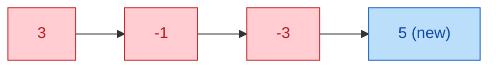
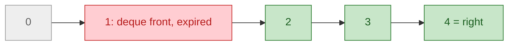
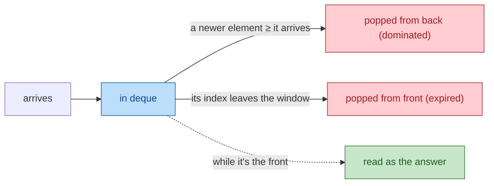

# 06a. Monotonic Deques: Mechanics (companion to module 06)

A monotonic deque returns the **max or min of a moving window in O(1)**, with O(n) total work. This companion covers how it works step by step so you can build either kind from scratch and use it beyond plain windows. Code: `code/06a_monotonic_deques.py`.

## At a glance

- **Use when:** you need the max or min of a forward-moving window (fixed or variable), or the best of the last k DP values.
- **Max deque:** values **decreasing** front → back. **Min deque:** values **increasing**.
- **Operations:** pop *dominated* from the **back** when adding, pop *expired* from the **front**, read the **front**.
- **Cost:** O(n) total: each element is pushed once and popped at most once.
- **Top trap:** expiring by value instead of index, or reading before expiring.

---

## 1. Core idea: keep only candidates

For a window **max**, an element is useless once a **newer element is at least as large**: the newer one is as big and leaves the window later. It's **dominated**. The deque keeps only the candidates that aren't dominated, which is why it doesn't hold the whole window and stays sorted on its own.

```
window [5, 2, 4]   max candidates: [5, 4]   (2 is smaller and older than 4)
```

## 2. Invariants: max vs min

| | Max deque | Min deque |
|---|---|---|
| Indices front → back | increasing (oldest first) | increasing (oldest first) |
| Values front → back | **decreasing** | **increasing** |
| Pop back while (adding `x`) | `nums[dq[-1]] <= x` | `nums[dq[-1]] >= x` |
| Front holds | window **max** | window **min** |

The front is the **best and oldest** candidate. When it expires, the next one in line is the next-best. Only the comparison differs between the two kinds. For max − min, keep both and update both every step.

## 3. Adding: pop dominated from the back

Pop every back element the newcomer dominates, then append. Pushing **5** into the max deque `[3, -1, -3]`:



All three are ≤ 5, so they're popped (red), leaving `[5]`. A newcomer smaller than the back pops nothing and is just appended. The order is never sorted explicitly; it's preserved by this rule.

## 4. Removing and reading

| Where | Why | Rule |
|---|---|---|
| **Back** | Dominated by the newcomer | During the push (section 3) |
| **Front** | **Expired**: its index left the window | Fixed size k: `if dq[0] <= right - k`. Left edge `left`: `if dq[0] < left` |

Read the answer at `nums[dq[0]]`, **after** expiring. Expiry works on **indices**, which is why the deque stores indices or `(index, value)` pairs. Window `k = 3`, `right = 4`: the window is `[2, 4]`, so a front at index 1 has expired (`1 <= 4 - 3`):



In a fixed window at most one element expires per step, so `if` suffices. Use `while` if the left edge can jump.

## 5. Order of operations per step

| Use | Order | Why |
|---|---|---|
| **Fixed window** | push → expire → read | The newcomer belongs to the window |
| **Variable window** (max − min ≤ limit) | push into both → while invalid: `left += 1`, expire fronts `< left` → record | Validity needs the current max/min, including `right` |
| **DP over last k** (Jump Game VI) | expire → read → compute `dp[i]` → push it | `dp[i]` uses only earlier values |
| **Pairs i < j** (Max Value of Equation) | expire → read → push | `j` mustn't pair with itself |

## 6. Duplicates: `<=` vs `<`

- **`<=` pops equal values** (keeps the newest). Safe with **index** expiry, and it's the default here.
- **`<` keeps equal values.** Required with **value** expiry (`if dq[0] == nums[left]`); otherwise you may pop a copy that's still in the window.

Index expiry works with either (`<=` keeps the deque shorter). Value expiry **requires** `<`.

## 7. Why it's O(n)

Every element follows the same lifecycle: one push, then at most one pop.



At most n pushes and n pops in total gives O(n), even though a single step's `while` can pop many elements.

---

## 8. Python examples

### Helper: both kinds in one class

```python
class MonotonicDeque:

    def __init__(self, kind: str = "max"):
        self.dq: deque[tuple[int, int]] = deque()
        self.is_max = kind == "max"

    def push(self, i: int, value: int) -> None:
        # Pop dominated elements: older AND not better than the newcomer.
        while self.dq and (self.dq[-1][1] <= value if self.is_max else self.dq[-1][1] >= value):
            self.dq.pop()
        self.dq.append((i, value))

    def expire(self, window_start: int) -> None:
        # Drop elements whose index has left the window [window_start, ...].
        while self.dq and self.dq[0][0] < window_start:
            self.dq.popleft()

    def best(self) -> int:
        return self.dq[0][1]
```

Call `push(i, value)`, `expire(window_start)`, `best()`. Storing `(index, value)` lets it work over any derived values.

### Example 1: Window max (fixed size)

[Sliding Window Maximum (239)](https://leetcode.com/problems/sliding-window-maximum/) · max deque · push → expire → read

```python
def window_max(nums: list[int], k: int) -> list[int]:
    dq: deque[int] = deque()                 # indices; values decreasing
    out = []
    for right, x in enumerate(nums):
        while dq and nums[dq[-1]] <= x:      # 1. remove dominated from the back
            dq.pop()
        dq.append(right)                     # 2. add the newcomer
        if dq[0] <= right - k:               # 3. expire the front
            dq.popleft()
        if right >= k - 1:                   # 4. read the front
            out.append(nums[dq[0]])
    return out
```

Trace for `[1, 3, -1, -3, 5, 3, 6, 7]`, k = 3 (deque as values):

| right | x | after push | expire? | read |
|---|---|---|---|---|
| 0 | 1 | `[1]` | | |
| 1 | 3 | `[3]` (popped 1) | | |
| 2 | −1 | `[3, -1]` | | **3** |
| 3 | −3 | `[3, -1, -3]` | index 1 > 0: no | **3** |
| 4 | 5 | `[5]` (popped all) | | **5** |
| 5 | 3 | `[5, 3]` | index 4 > 2: no | **5** |
| 6 | 6 | `[6]` | | **6** |
| 7 | 7 | `[7]` | | **7** |

### Example 2: Window min

min deque · only the comparison flips

```python
def window_min(nums: list[int], k: int) -> list[int]:
    dq: deque[int] = deque()                 # indices; values increasing
    out = []
    for right, x in enumerate(nums):
        while dq and nums[dq[-1]] >= x:      # mirror image: pop larger values
            dq.pop()
        dq.append(right)
        if dq[0] <= right - k:
            dq.popleft()
        if right >= k - 1:
            out.append(nums[dq[0]])
    return out
```

Same input → `[-1, -3, -3, -3, 3, 3]`.

### Example 3: Both deques, variable window

[Longest Continuous Subarray With Absolute Diff Less Than or Equal to Limit (1438)](https://leetcode.com/problems/longest-continuous-subarray-with-absolute-diff-less-than-or-equal-to-limit/) · max + min · longest-window template (module 06, Template 2)

```python
def longest_within_limit(nums: list[int], limit: int) -> int:
    maxdq: deque[int] = deque()              # indices; values decreasing
    mindq: deque[int] = deque()              # indices; values increasing
    left = best = 0
    for right, x in enumerate(nums):
        while maxdq and nums[maxdq[-1]] <= x:
            maxdq.pop()
        maxdq.append(right)
        while mindq and nums[mindq[-1]] >= x:
            mindq.pop()
        mindq.append(right)
        while nums[maxdq[0]] - nums[mindq[0]] > limit:   # invalid: shrink
            left += 1
            if maxdq[0] < left:              # expire by index, not by value
                maxdq.popleft()
            if mindq[0] < left:
                mindq.popleft()
        best = max(best, right - left + 1)
    return best
```

Validity is `max − min ≤ limit`, read from the two fronts. Shrinking moves `left`, then expires fronts with index `< left`, so `<=`/`>=` pops are safe. Module 06's Example C.1 uses the other valid combination: value expiry with strict pops.

### Example 4: Both deques plus counting

[Continuous Subarrays (2762)](https://leetcode.com/problems/continuous-subarrays/) · max + min · "at most" counting (module 06, Template 4)

```python
def count_continuous_subarrays(nums: list[int], limit: int = 2) -> int:
    maxdq: deque[int] = deque()
    mindq: deque[int] = deque()
    left = total = 0
    for right, x in enumerate(nums):
        while maxdq and nums[maxdq[-1]] <= x:
            maxdq.pop()
        maxdq.append(right)
        while mindq and nums[mindq[-1]] >= x:
            mindq.pop()
        mindq.append(right)
        while nums[maxdq[0]] - nums[mindq[0]] > limit:
            left += 1
            if maxdq[0] < left:
                maxdq.popleft()
            if mindq[0] < left:
                mindq.popleft()
        total += right - left + 1            # "at most" counting: valid starts = [left, right]
    return total
```

Example 3's loop with one change: add `right - left + 1` (all valid starts for this `right`) instead of tracking the longest.

### Example 5: Max deque over DP values

[Jump Game VI (1696)](https://leetcode.com/problems/jump-game-vi/) · max deque of `dp` indices · expire → read → push

```python
def max_result_jump(nums: list[int], k: int) -> int:
    dp = [0] * len(nums)
    dp[0] = nums[0]
    dq: deque[int] = deque([0])              # indices of dp; dp values decreasing
    for i in range(1, len(nums)):
        if dq[0] < i - k:                    # expire: can only jump from [i-k, i-1]
            dq.popleft()
        dp[i] = nums[i] + dp[dq[0]]          # best reachable predecessor
        while dq and dp[dq[-1]] <= dp[i]:
            dq.pop()
        dq.append(i)
    return dp[-1]
```

`dp[i] = nums[i] + max(dp[i-k … i-1])`: the deque makes each step O(1) instead of O(k). [Constrained Subsequence Sum (1425)](https://leetcode.com/problems/constrained-subsequence-sum/) has the same shape with `dp[i] = nums[i] + max(0, best)`.

### Example 6: Max deque over a transformed value

[Max Value of Equation (1499)](https://leetcode.com/problems/max-value-of-equation/) · max deque of `y − x` · expire → read → push

```python
def max_value_of_equation(points: list[list[int]], k: int) -> int:
    # yi + yj + |xi - xj| with xi < xj  ==  (yi - xi) + (yj + xj).
    # For each j, need max (yi - xi) over earlier i with xj - xi <= k.
    dq: deque[tuple[int, int]] = deque()     # (x, y - x); (y - x) decreasing
    best = -float("inf")
    for x, y in points:
        while dq and x - dq[0][0] > k:       # expire points too far left
            dq.popleft()
        if dq:
            best = max(best, dq[0][1] + y + x)
        while dq and dq[-1][1] <= y - x:     # push y - x, popping dominated
            dq.pop()
        dq.append((x, y - x))
    return best
```

Rewrite so one part depends only on `i`: `yi + yj + (xj − xi) = (yi − xi) + (yj + xj)`. For each `j`, take the window max of `yi − xi` over earlier points within distance k. The deque can hold any derived value.

### Related: increasing deque over prefix sums

[Shortest Subarray with Sum at Least K (862)](https://leetcode.com/problems/shortest-subarray-with-sum-at-least-k/) pops the **front** for a different reason: once a front prefix forms a valid subarray, no later end can do better with it. See module 08, Example 4.1.

---

## 9. Pitfalls

- Value expiry with `<=` pops (pops a duplicate still in the window).
- Reading the front before expiring.
- Fixed-window off-by-one: expire when `dq[0] <= right - k`.
- In DP or pair problems, pushing before reading (the element pairs with itself).
- `list.pop(0)` is O(n); use `collections.deque`.
- With two deques, flipping the comparison in one place but not the other.

## 10. Practice

- [Sliding Window Maximum (239)](https://leetcode.com/problems/sliding-window-maximum/) · Hard · Example 1.
- [Longest Continuous Subarray With Absolute Diff Less Than or Equal to Limit (1438)](https://leetcode.com/problems/longest-continuous-subarray-with-absolute-diff-less-than-or-equal-to-limit/) · Medium · Example 3.
- [Continuous Subarrays (2762)](https://leetcode.com/problems/continuous-subarrays/) · Medium · Example 4.
- [Jump Game VI (1696)](https://leetcode.com/problems/jump-game-vi/) · Medium · Example 5.
- [Constrained Subsequence Sum (1425)](https://leetcode.com/problems/constrained-subsequence-sum/) · Hard · Example 5's shape with `max(0, best)`.
- [Max Value of Equation (1499)](https://leetcode.com/problems/max-value-of-equation/) · Hard · Example 6.
- [Shortest Subarray with Sum at Least K (862)](https://leetcode.com/problems/shortest-subarray-with-sum-at-least-k/) · Hard · Increasing deque over prefix sums (module 08).

## Self-check

1. Why can an older element that's no larger than the newcomer be discarded for good?
2. State both invariants of a max deque and why each matters.
3. Back pops vs front pops: what triggers each?
4. Why store indices instead of values?
5. When do you need `<` pops instead of `<=`?
6. In Jump Game VI, why read the front before pushing `dp[i]`?
7. Why is the total O(n) despite the nested `while`?
8. How do you turn a window-max implementation into a window-min one?
