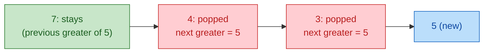
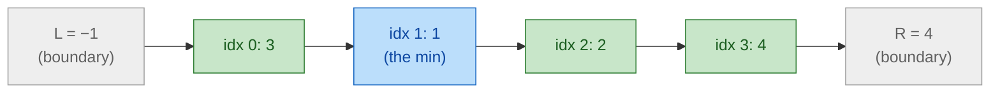
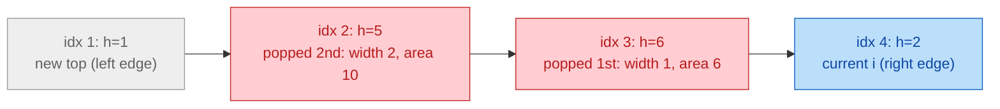

# 08a. Monotonic Stacks: Mechanics (companion to module 08)

A monotonic stack finds, for every element, its **nearest greater or smaller neighbor** (next or previous) in O(n) total. This companion covers how it works (what gets popped, who answers whom, duplicates, sentinels) and the contribution technique. Code: `code/08a_monotonic_stacks.py`.

## At a glance

- **Use when:** "next / previous greater or smaller", "how many days until", "span", "largest rectangle", "sum over all subarrays of min/max".
- **Rule of thumb:** looking for something **greater** → keep values **decreasing**; **smaller** → **increasing**.
- **Who answers:** for **next**, the newcomer answers each element it pops. For **previous**, the element left on top answers the newcomer.
- **Cost:** O(n): each index is pushed once and popped at most once.
- **Top trap:** wrong strictness with duplicates, especially when counting subarrays.

---

## 1. Core idea

Scan left to right. The stack holds elements **still waiting** for their answer. When a newcomer `x` arrives:
- Every waiting element that `x` beats has found its **next** greater (or smaller): pop it and record `x` as its answer.
- Whatever remains on top is the newcomer's **previous** greater (or smaller).

Popped elements are never needed again: `x` is closer than they are to everything that comes later, and at least as good.

## 2. One push, two answers

Decreasing stack `[7, 4, 3]` (looking for greater), newcomer **5**:



After the pops, push 5, giving `[7, 5]`. The stack stays decreasing without ever being sorted.

## 3. The four variants

| Goal | Stack values (bottom → top) | Pop while (`x` = newcomer) | Answer recorded |
|---|---|---|---|
| **Next greater** | decreasing | `nums[top] < x` | each popped element's answer = `x` |
| **Next smaller** | increasing | `nums[top] > x` | each popped element's answer = `x` |
| **Previous greater** | decreasing | `nums[top] <= x` | after popping, `top` answers `x` |
| **Previous smaller** | increasing | `nums[top] >= x` | after popping, `top` answers `x` |

Store **indices**, not values, so you can compute distances (`i − j`) and widths, and look values up with `nums[idx]`.

## 4. Duplicates and strictness

Flipping `<` ↔ `<=` decides whether equal values count as "greater":
- **Next strictly greater:** pop while `< x`. **Next greater-or-equal:** pop while `<= x`.
- **Previous strictly greater:** pop while `<= x`. **Previous greater-or-equal:** pop while `< x`.

For **counting subarrays** (section 7), the two sides must be **asymmetric**, one strict and one non-strict. Otherwise a subarray with two equal minimums is counted twice, or not at all.

## 5. Elements left at the end

Elements still on the stack after the scan have **no next** greater/smaller: their answer is the default (`-1`, `0`, or `n`). Two common ways to handle them:
- **Defaults:** initialize the answers to `-1` (or `n`) and leave them.
- **Sentinel:** append a value that pops everything at the end (e.g., `0` for histogram heights), so every element is processed inside the loop.

## 6. Why it's O(n)

Each index is pushed once and popped at most once, so there are at most 2n stack operations in total. The inner `while` is amortized, the same argument as for monotonic deques.

## 7. The contribution technique

To sum `min` (or `max`) over **all subarrays** without listing them, ask how many subarrays have `arr[i]` as their minimum. If `L` is the previous smaller index and `R` the next smaller-or-equal index, any subarray with a start in `(L, i]` and an end in `[i, R)` has `arr[i]` as its min:

`count = (i − L) × (R − i)`, so `arr[i]` contributes `arr[i] × count`.

For `arr = [3, 1, 2, 4]`, element `1` at index 1 has `L = −1` and `R = 4`:



Starts: 2 choices (idx 0, 1). Ends: 3 choices (idx 1, 2, 3). That's 6 subarrays where 1 is the min, contributing 1 × 6 = 6. Summing over all elements gives 3 + 6 + 4 + 4 = 17.

---

## 8. Python examples

### The two core forms

```python
def next_greater_index(nums: list[int]) -> list[int]:
    res = [-1] * len(nums)
    stack: list[int] = []                    # indices; values decreasing bottom -> top
    for i, x in enumerate(nums):
        while stack and nums[stack[-1]] < x:  # x answers everyone it beats
            res[stack.pop()] = i
        stack.append(i)
    return res                               # still on the stack: no next greater (-1)
```

```python
def prev_smaller_index(nums: list[int]) -> list[int]:
    res = [-1] * len(nums)
    stack: list[int] = []                    # indices; values increasing bottom -> top
    for i, x in enumerate(nums):
        while stack and nums[stack[-1]] >= x:  # pop anything that can't be "smaller" for x or later
            stack.pop()
        res[i] = stack[-1] if stack else -1  # the survivor answers the newcomer
        stack.append(i)
    return res
```

The same loop does both jobs: assign answers to the **popped** elements (next), or to the **newcomer** from the survivor on top (previous). Example 5 does both in one pass.

### Example 1: Distance to the next greater

[Daily Temperatures (739)](https://leetcode.com/problems/daily-temperatures/) · next greater · answer = `i − j`

```python
def daily_temperatures(temps: list[int]) -> list[int]:
    res = [0] * len(temps)
    stack: list[int] = []                    # indices of days still waiting for a warmer day
    for i, t in enumerate(temps):
        while stack and temps[stack[-1]] < t:
            j = stack.pop()
            res[j] = i - j                   # popped day j is answered by day i
        stack.append(i)
    return res
```

The stack holds days still waiting for a warmer one. Each warmer day answers every cooler day it pops.

### Example 2: Previous greater, online

[Online Stock Span (901)](https://leetcode.com/problems/online-stock-span/) · previous greater · merge popped spans

```python
class StockSpanner:
    def __init__(self) -> None:
        self.stack: list[tuple[int, int]] = []   # (price, span); prices decreasing

    def next(self, price: int) -> int:
        span = 1
        while self.stack and self.stack[-1][0] <= price:
            span += self.stack.pop()[1]          # absorb the days the popped price covered
        self.stack.append((price, span))
        return span
```

Prices arrive one at a time, so there are no indices. Instead, each entry stores the span it covers. A popped price's span is absorbed by the newcomer, which keeps every call O(1) amortized.

### Example 3: Circular arrays

[Next Greater Element II (503)](https://leetcode.com/problems/next-greater-element-ii/) · next greater · two laps

```python
def next_greater_circular(nums: list[int]) -> list[int]:
    n = len(nums)
    res = [-1] * n
    stack: list[int] = []
    for k in range(2 * n):                   # second lap lets elements near the end see the start
        i = k % n
        while stack and nums[stack[-1]] < nums[i]:
            res[stack.pop()] = nums[i]
        if k < n:                            # push each index only once
            stack.append(i)
    return res
```

The second lap lets elements near the end find a greater value at the start. Push only on the first lap, so each index enters the stack once.

### Example 4: Both boundaries at pop time

[Largest Rectangle in Histogram (84)](https://leetcode.com/problems/largest-rectangle-in-histogram/) · increasing stack · sentinel `0`

```python
def largest_rectangle(heights: list[int]) -> int:
    best = 0
    stack: list[int] = []                    # indices; heights increasing
    for i, h in enumerate(heights + [0]):    # sentinel 0 flushes the stack at the end
        while stack and heights[stack[-1]] > h:
            height = heights[stack.pop()]
            left = stack[-1] if stack else -1      # previous smaller (left boundary)
            best = max(best, height * (i - left - 1))  # i = next smaller (right boundary)
        stack.append(i)
    return best
```

When bar `j` is popped by `i`, the bar's rectangle extends from the new top + 1 (previous smaller) to `i − 1` (next smaller), so its width is `i − top − 1`. For `[2, 1, 5, 6, 2, 3]` at `i = 4` (height 2):



The best area is 10. [Maximal Rectangle (85)](https://leetcode.com/problems/maximal-rectangle/) runs this per row of a 0/1 matrix.

### Example 5: Contribution technique

[Sum of Subarray Minimums (907)](https://leetcode.com/problems/sum-of-subarray-minimums/) · both boundaries in one pass · asymmetric strictness

```python
def sum_subarray_mins(arr: list[int]) -> int:
    MOD = 10**9 + 7
    n = len(arr)
    left = [-1] * n                          # previous strictly smaller
    right = [n] * n                          # next smaller-or-equal
    stack: list[int] = []
    for i, x in enumerate(arr):
        while stack and arr[stack[-1]] >= x:
            right[stack.pop()] = i           # popped element's next smaller-or-equal is i
        left[i] = stack[-1] if stack else -1 # survivor is strictly smaller
        stack.append(i)
    total = 0
    for i, x in enumerate(arr):
        total += x * (i - left[i]) * (right[i] - i)   # subarrays where arr[i] is "the" min
    return total % MOD
```

One pass fills both arrays. A popped element gets its `right` (next smaller-or-equal). The newcomer gets its `left` from the survivor (previous strictly smaller). Using `>=` when popping makes `right` non-strict and `left` strict, so each subarray is counted exactly once even with duplicate minimums.

### Example 6: Max and min contributions together

[Sum of Subarray Ranges (2104)](https://leetcode.com/problems/sum-of-subarray-ranges/) · sum of maxes − sum of mins

```python
def sum_subarray_ranges(nums: list[int]) -> int:
    def contribution(sign: int) -> int:
        # sign=+1: sum of subarray maxima; sign=-1: sum of minima (by negating values)
        a = [sign * v for v in nums]
        n = len(a)
        left, right, stack = [-1] * n, [n] * n, []
        for i, x in enumerate(a):
            while stack and a[stack[-1]] <= x:     # max form: pop smaller-or-equal
                right[stack.pop()] = i
            left[i] = stack[-1] if stack else -1
            stack.append(i)
        return sum(a[i] * (i - left[i]) * (right[i] - i) for i in range(n))
    return contribution(1) + contribution(-1)      # sum(max) - sum(min)
```

Sum of (max − min) over all subarrays = Σ max − Σ min. Negating the values turns a max computation into a min computation, so one function handles both.

### Example 7: Greedy with an increasing stack

[Remove K Digits (402)](https://leetcode.com/problems/remove-k-digits/) · increasing stack · pop while removals remain

```python
def remove_k_digits(num: str, k: int) -> str:
    stack: list[str] = []
    for d in num:
        while k and stack and stack[-1] > d:   # a bigger digit before a smaller one: drop it
            stack.pop()
            k -= 1
        stack.append(d)
    if k:
        stack = stack[:-k]                     # still need removals: drop from the end
    return "".join(stack).lstrip("0") or "0"
```

To make the smallest number, remove any digit that's bigger than the digit after it, since that improves an earlier position. The stack applies this from left to right. Removals left over come off the end, and leading zeros are stripped.

---

## 9. Pitfalls

- Mixing up who answers: for **next**, the popped element gets the answer; for **previous**, the newcomer does.
- Wrong strictness for "greater" vs "greater-or-equal", or symmetric strictness in contribution counting (double counts).
- Forgetting the elements left on the stack: use defaults or a sentinel.
- Storing values when you need distances or widths: store indices.
- Histogram width off-by-one: `i − top − 1` with the new top, or `i` when the stack is empty.
- Circular arrays: pushing on the second lap (indices enter twice).

## 10. Practice

- [Next Greater Element I (496)](https://leetcode.com/problems/next-greater-element-i/) · Easy · Next greater + hash map lookup.
- [Daily Temperatures (739)](https://leetcode.com/problems/daily-temperatures/) · Medium · Example 1.
- [Online Stock Span (901)](https://leetcode.com/problems/online-stock-span/) · Medium · Example 2.
- [Next Greater Element II (503)](https://leetcode.com/problems/next-greater-element-ii/) · Medium · Example 3.
- [Sum of Subarray Minimums (907)](https://leetcode.com/problems/sum-of-subarray-minimums/) · Medium · Example 5.
- [Sum of Subarray Ranges (2104)](https://leetcode.com/problems/sum-of-subarray-ranges/) · Medium · Example 6.
- [Remove K Digits (402)](https://leetcode.com/problems/remove-k-digits/) · Medium · Example 7.
- [Largest Rectangle in Histogram (84)](https://leetcode.com/problems/largest-rectangle-in-histogram/) · Hard · Example 4.
- [Maximal Rectangle (85)](https://leetcode.com/problems/maximal-rectangle/) · Hard · Example 4 per row.
- [Trapping Rain Water (42)](https://leetcode.com/problems/trapping-rain-water/) · Hard · Stack version: each pop fills water between the new top and `i`.

## Self-check

1. For "next greater", which element records the answer when a pop happens? For "previous greater"?
2. Why is it safe to discard a popped element for good?
3. Which stack direction (increasing or decreasing) finds the next smaller element?
4. How do you change "next strictly greater" into "next greater-or-equal"?
5. In the contribution technique, why must one side be strict and the other non-strict?
6. What does a sentinel do, and when do you need one?
7. In the histogram, why is the width `i − top − 1` after the pop?
8. Why is the total work O(n)?
